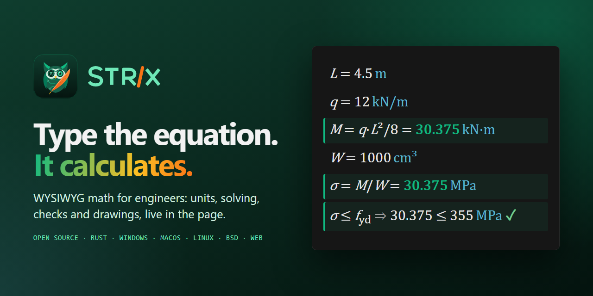
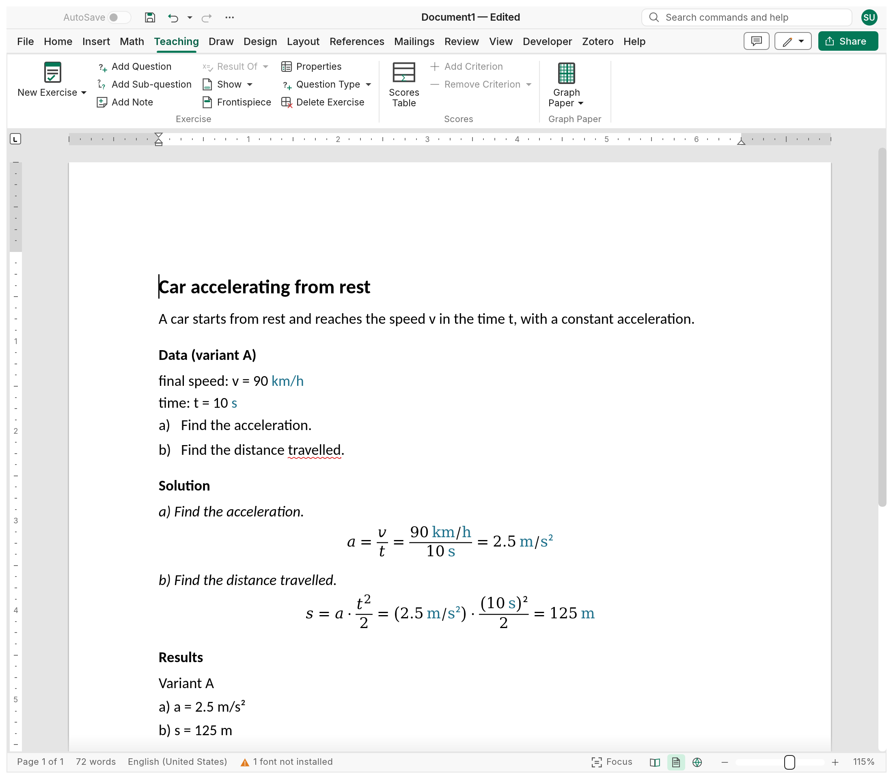
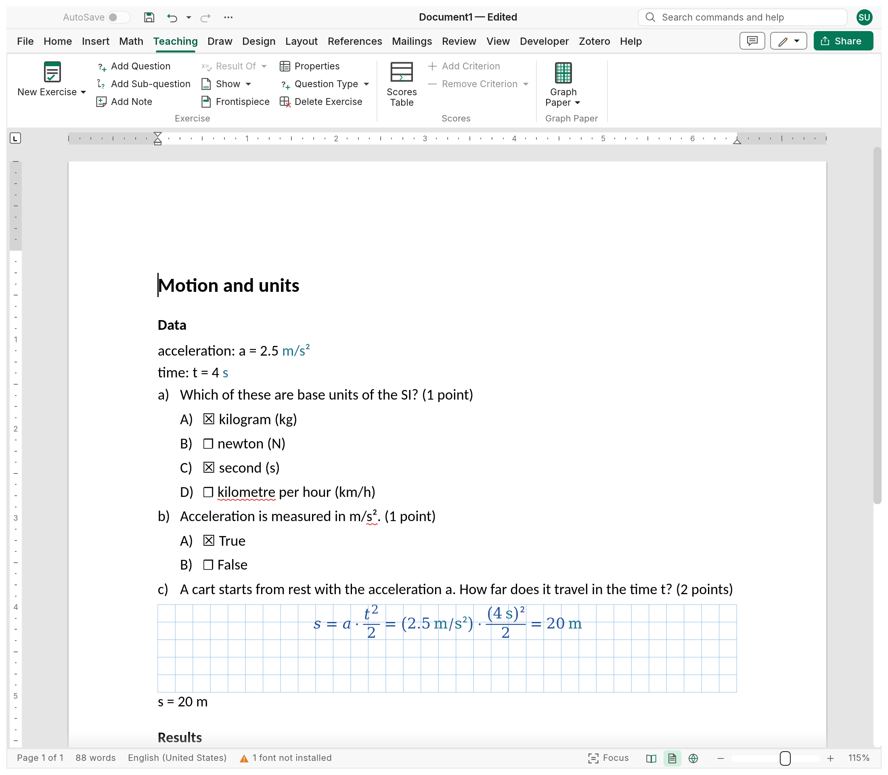
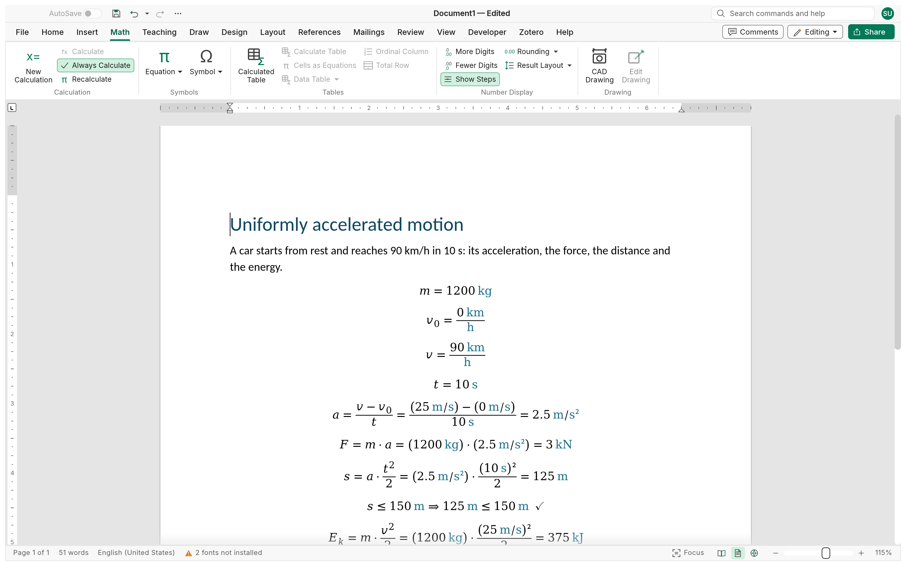

<!-- Modified by the Strix contributors (fork of WordCraft); see NOTICE. -->
<p align="center">
  
</p>

<h1 align="center">Strix Writer</h1>

<p align="center">
  <b>Tests and exercises for teachers: write the test, Strix keeps the solutions and the scores.</b>
</p>

<p align="center">
  Strix Writer (Strix for short) is an open-source editor, written in pure Rust, for preparing
  tests. Calculation exercises keep their data, solution and results live, with variants A, B, C
  for each row of desks; multiple-choice, true/false and open questions carry their points; one
  file per exercise makes an archive, and a test is put together from it, with or without the
  solutions. A scores table adds the points up by criterion by itself; a grading grid that turns
  points into marks is planned. Underneath, the equations in the page calculate, with units. It
  runs natively on Windows, macOS, Linux and BSD, and in the browser via WebAssembly.
</p>

<p align="center">
  
  
  
  
</p>

<p align="center">
  <a href="https://nabre.github.io/strix/"><b>Website</b></a> ·
  <a href="https://github.com/nabre/strix/releases/latest"><b>Download</b></a> ·
  <a href="https://nabre.github.io/strix/app/?sample"><b>Try it in the browser</b></a> ·
  <a href="https://github.com/nabre/strix/issues"><b>Issues</b></a>
</p>

<p align="center">English · <a href="docs/README.it.md">Italiano</a> · <a href="docs/README.fr.md">Français</a> · <a href="docs/README.de.md">Deutsch</a></p>

<p align="center">
  
</p>

<p align="center">
  <a href="#calculation-exercises">Exercises</a> ·
  <a href="#multiple-choice-and-open-questions">Multiple choice</a> ·
  <a href="#from-the-archive-to-the-test">Tests</a> ·
  <a href="#scores-and-grading">Scores</a> ·
  <a href="#wysiwyg-math">WYSIWYG math</a> ·
  <a href="#cad-drawings-driven-by-the-calculations">CAD drawings</a> ·
  <a href="#a-full-document-editor-underneath">Document editor</a> ·
  <a href="#files">Files</a> ·
  <a href="#for-agents-commands-cli-mcp">For agents</a> ·
  <a href="#build-and-run">Build and run</a> ·
  <a href="#status-and-roadmap">Roadmap</a> ·
  <a href="#license-and-credits">License</a>
</p>

> **Status: alpha.** The document editor Strix is built on is mature; the exercises, the
> calculation engine and CAD are new and moving fast. Keep a copy of important documents, and
> [tell us what breaks](https://github.com/nabre/strix/issues).

## Calculation exercises

**Teaching › Exercise › New Exercise** inserts a worked problem with a structure that editing can't break:

- a title, the **statement** (free content: text, figures, tables, equations, drawings), the
  **data** (symbol, description, value, unit) and the **questions**, lettered and nested up to
  three levels (a), a.1), a.1.1)), with notes between them;
- the **solution**, where each question is repeated as a read-only line with room to work it out
  under it; the working stays with its question when the questions change;
- one **results summary** at the end of the document: an equation marked as the result of a
  question (Result Of) is listed with its calculated value (`a) a = 2.5 m/s²`).

The solution is a live calculation (see [WYSIWYG math](#wysiwyg-math)): the data can have
**variants** A, B, C…, and choosing one recalculates the data, the solution and the summary, so
each row of desks gets its own numbers and no solution is redone by hand. Each exercise is a
**sandbox**: two exercises can both define `t`. Graph paper can follow the questions, as in an
exercise book, and a [CAD drawing](#cad-drawings-driven-by-the-calculations) in the statement
follows the data.

<p align="center">
  <picture>
    <source media="(prefers-color-scheme: dark)" srcset="site/shots/en/shot-exercise-dark.png">
    
  </picture>
</p>

## Multiple choice and open questions

An exercise can also be a quiz (`exercise.insert {"kind"}`), where each question has its own
mode, so one quiz mixes them ([docs/question-modes.md](docs/question-modes.md)):

| Mode | What the student gets | What the corrected copy shows |
|---|---|---|
| **Open answer** | an answer space of a height in cm, squared or blank | the answer written in the space |
| **Multiple choice** | options A), B), C)… with empty check boxes | the correct boxes ticked (more than one can be) |
| **True/False** | *True* and *False* with empty boxes | the right one ticked |
| **Calculation** | a squared space for the working, then `Answer: s = ______ m` | the working as live equations and `Answer: s = 20 m` |
| **CAD drawing** | a squared space to draw in | the solution's CAD drawing |

A **problem** (statement, data, questions, the solution worked under each question) stays the
kind for long multi-step exercises.

The correct answers are ticked in the exercise and **hide with the solution**: the boxes go
empty and the answer spaces keep their height, so the student's copy is laid out exactly like the
teacher's. Each question has its **points**, shown after it and added up in the scores table. A
quiz needs no statement, and a lone question has no letter.

<p align="center">
  <picture>
    <source media="(prefers-color-scheme: dark)" srcset="site/shots/en/shot-quiz-dark.png">
    
  </picture>
</p>

## From the archive to the test

- **One file per exercise** makes an archive. Each file carries its **archive properties**
  (grade, section, subject, teacher, duration and the score), saved so that Word shows them too
  ([docs/archive.md](docs/archive.md)).
- A **master document** puts a test together from those files: its own numbering, frontispiece
  (cover page), page breaks and parts shown (with or without the solutions and the results);
  another master can lay out the same series another way. **None of it changes the files**
  ([docs/master-documents.md](docs/master-documents.md)).
- **DSA formatting** (Design › Document Formatting › DSA) lays the same test out for students
  with specific learning difficulties: Reading, Writing, Maths and memory, combinable, the page
  always white ([docs/dsa.md](docs/dsa.md)).
- **PDF** export for printing; LaTeX, HTML and Markdown copies too.

## Scores and grading

A **scores table** (Teaching › Scores › Scores Table) lists the points of each exercise, to hand
out with the test:

| Exercise | IMP | | MOD | | CAL/RIS | | Total | |
|---|---|---|---|---|---|---|---|---|
| 1 | | 2 | | 2 | | 1 | | 5 |
| 2 | | 2 | | 2 | | 1 | | 5 |
| Total | | 4 | | 4 | | 2 | | 10 |

- one **row per exercise**, gathered by itself (a new exercise adds its row);
- each **criterion** (IMP, MOD, CAL/RIS…, named as you like) has two columns: the points given on
  the sheet and the points the exercise is worth;
- **totals** across and down follow as points are typed; the grand total is the document's
  **Score** property.

*Planned:* a **grading grid** that turns points into marks (thresholds, scale, rounding).
Details: [docs/exercise.md](docs/exercise.md).

## WYSIWYG math

There is no separate worksheet, no code cell and no formula bar. An equation in the document *is*
the calculation, typed in place with the equation editor and shown as typeset math. Strix reads
every calculated equation in reading order, like a worksheet, and keeps its results up to date:
after each edit (waiting until the caret leaves the equation, so nothing is rewritten while you
type), on F9 and when the file opens.

```text
m = 1200 kg                        defines m
v_0 = 0 km/h
v = 90 km/h                        units convert by themselves: km/h, s, m/s
t = 10 s
a = (v − v_0)/t =                  →  a = (v − v₀)/t = 2.5 m/s²
F = m·a =                          →  F = m·a = 3 kN
s = a·t²/2 =                       →  s = a·t²/2 = 125 m
s ≤ 150 m                          →  s ≤ 150 m ⇒ 125 m ≤ 150 m ✓
E_k = m·v²/2 = kJ                  →  E_k = m·v²/2 = 375 kJ        (the unit chosen after =)
v² = 2·a·d                         →  v² = 2·a·d ⇒ d = 125 m         (d is the one unknown: solved)
```

<p align="center">
  <picture>
    <source media="(prefers-color-scheme: dark)" srcset="site/shots/en/shot-calc-dark.png">
    
  </picture>
</p>

- **One `=` for everything.** Strix works out what a statement means from what is known so far:
  a definition (`t = 10 s`), a result to show (`a =`, or `E_k = kJ` to choose the unit), a
  formula shown with its value (`s = a·t²/2 =`), an equation to **solve** for its one unknown
  (`v² = 2·a·d`, `x² + x = 6`), or a **check** (`a + b = c`, and `≤ ≥ < > ≠` with ✓/✗). `:=` still
  defines explicitly.
- **Solving.** The unknown is isolated symbolically when it appears once (through `+ − · /`,
  powers, roots, `exp ln log`, trigonometry and their inverses); otherwise it is found
  numerically and the smallest non-negative root wins.
- **Units everywhere.** SI base and derived units with prefixes, engineering units (`mm`, `kN`,
  `MPa`, `bar`, `kWh`, `t`, `h`…) and dimensionless ones kept through results (`%`, `‰`, `ppm`,
  `°`, `rad`, `gon`). Dimension errors (`2 m + 3 s`) are caught, never silently wrong. The
  **working unit** follows what you write: after `b = 30 cm`, lengths show in cm. Units are
  typeset upright and coloured with the **Unit** character style, so they stand apart from
  symbols. A unit typed in the wrong case gets a hint ("did you mean kN?").
- **Solution steps.** With Show Steps a formula or a solved equation shows the formula isolated
  for the unknown, the values substituted and the result, aligned at `=`, rebuilt on every
  recalculation.
- **Calculated tables.** Turn on Calculated Table and an ordinary table becomes a calculation:
  headers name columns with units and formulas (`m [g]`, `ρ [g/cm³] = m/V`), cells may hold
  their own statements, `Σ =`, `mean =`, `min =`, `max =` total a column, and every complete
  column becomes a vector for the rest of the document.

  | Trial | m [g] | V [cm³] | ρ [g/cm³] = m/V |
  |---|---|---|---|
  | 1 | 27.1 | 10 | *2.71* |
  | 2 | 54 | 20 | *2.7* |
  | 3 | 80.7 | 30 | *2.69* |
  | Mean | | | *mean = 2.7* |

- **Sums, ranges and vectors.** `∑_(i=1)^n▒i²`, `∏`, ranges `i = 1..5`, vectors
  `F = [1; 2; 3] kN` with indexing and element-wise arithmetic; `sum mean len min max`.
- **Number format.** Digits (default 3), automatic / decimal places / significant digits,
  trailing zeros, half-away-from-zero rounding, scientific notation for very large and very small
  values: on the Math tab.
- **Errors never stop the sheet.** A failing statement shows `⚠` and its message; later items
  still calculate.

The calculation tools are on the **Math** tab: New Calculation, Calculate (also the `=` button
beside an equation), Recalculate, Calculated Table, number format and CAD Drawing; exercises,
scores and graph paper are on the **Teaching** tab. Design and
details: [docs/calc.md](docs/calc.md).

## CAD drawings driven by the calculations

**Insert › CAD Drawing** (or Math › Drawing) places a technical drawing in the text. Its
coordinates, radii and angles can be numbers or **expressions of the calculation's parameters**
(`["b", 0]`, `b/2`), evaluated where the drawing sits in the document:

- change `b = 6 cm` above it and the triangle **redraws**, so each variant of an exercise gets
  its own figure;
- dimensions and texts recall parameters: `{{b}}` shows `6 cm`, `{{b:both}}` shows
  `b = 6 cm` (units in the Unit style), `<>` the measured size; a parameter that isn't defined
  there shows `[b?]` in red.

Double-click a drawing to edit it on its sheet, with a **CAD Drawing** tab and an AutoCAD-style
command line (`x,y`, `@dx,dy`, `@d<a`, direct distances, tool aliases): line, circle, arc,
polyline, rectangle, point, text, aligned / horizontal / vertical dimensions; select, move, copy,
delete; ortho, grid, zoom. **Object snaps** are exact, computed on the true curves by a geometry
kernel (endpoint, midpoint, centre, node, quadrant, intersection, perpendicular, tangent,
nearest); **grips** reshape selected objects and keep a coordinate's expression (`b` becomes
`b + 0.5`). Selection works as in AutoCAD: a click adds, Shift+click removes, a window, a
crossing or a lasso, fences and polygons, Previous, Undo, cycling through overlapping objects; the
**right button** opens a menu for what is under way (a command's options, the selected objects,
the drawing), with a snap for the next point on Shift+right-click. A **Properties pane** shows the
selection by family or object by object, edits layer, colour, lineweight and linetype, and the
geometry with numbers or calculation expressions; it manages the **layers** too. The drawing is
stored as JSON in the `.xmath` file together with an automatic SVG
picture, so other programs still show it. Details: [docs/cad.md](docs/cad.md).

*Planned for CAD:* offset, trim, extend, fillet, mirror and the other modify tools, match
properties, angular dimensions, hatches, rotated texts, and driving dimensions
with geometric constraints.

## Graph paper

**Insert › Graph Paper** rules the page in squares, as in an exercise book, for working a
problem by hand or sketching: the side of a square, the line style, colour and weight, and a
heavier line every N squares. The grid can be the **background** of every page of a section,
or a block in the text that runs **to the end of the page**, **until the next odd or even
page**, **for a number of pages** or **for a given height**; the text can be written over it.
It is drawn from those numbers, so it stays sharp at any zoom and in PDF. Details:
[docs/graph-paper.md](docs/graph-paper.md).

## A full document editor underneath

Strix grew out of a word processor that aims at Microsoft Word parity (it is a fork of WordCraft,
see [License and credits](#license-and-credits)), so the report around a calculation is a real
document: a familiar ribbon interface, styles, headings, lists, tables, equations, pictures and
shapes, headers and footers, sections and columns, footnotes, citations and tables of contents,
comments and track changes, spelling and hyphenation, mail merge and printing. The interface
follows the operating system's language (English, Italian, German or French; File › Options ›
Interface language picks one by hand). The editor's plan is WordCraft's: [WordCraft roadmap](https://github.com/storytold/wordcraft/blob/main/ROADMAP.md).

## Files

| | Formats |
|---|---|
| **Saves** | `.xmath` (Strix document) and `.xmathm` (Strix template): an OOXML package that keeps calculations, exercises and drawings live |
| **Saves back** (documents without Strix objects) | `.docx`, `.docm`, `.dotx`, `.dotm`, `.odt`, `.rtf`, `.txt`, Word XML |
| **Exports** (static copies) | PDF, PNG, LaTeX (`.tex`), HTML, Markdown |
| **Opens** | `.docx`, `.docm`, `.dotx`, `.dotm`, `.doc`, `.odt`, `.rtf`, `.md`, `.html`, `.tex`, `.txt`, Word XML |

Like Word, Strix opens a `.docx` (or `.odt`, `.rtf`…) and saves it back in the same format. That
holds as long as the document has no **Strix objects**: calculations, calculated tables,
exercises, CAD drawings or graph paper. Those formats would keep at most their last look and lose
the live calculations and the drawings' source, so a document with any saves only as `.xmath`:
Save proposes a `.xmath` of the same name and says what would be lost ("3 calculations, 1 CAD
drawing"), Save As leaves out the formats that would lose them, and `file.save`, `strix-cli
convert` and MCP `save_document` refuse with the same explanation instead of writing a lossy
file. Exports to PDF, PNG, LaTeX, HTML and Markdown are copies and always work. A new document is
a `.xmath`. A `.xmath` file stays a standard package, so other programs show the last computed
values as ordinary equations, tables and pictures.

## For agents: commands, CLI, MCP

Everything Strix does is a **command** in one registry, with an id, parameters and a ribbon
location. The ribbon, keyboard shortcuts, command search, the command line, the control channel
and the MCP server all dispatch the same commands, and programmatic calls never open dialogs.
The teaching, calculation and drawing commands include `exercise.insert`, `exercise.questions`,
`exercise.setData`, `exercise.variant`, `exercise.show`, `exercise.scores`, `archive.properties`,
`design.dsa`, `equation.answer`, `calc.insert`, `calc.recalculate`, `table.calc`, `insert.cad` and
`cad.set`, so an agent can prepare a whole test with its variants.

```sh
claude mcp add strix -- strix-cli mcp                      # headless documents
# confine the agent to folders: strix-cli mcp --automation-read-root DIR --automation-write-root DIR
strix --control 7981 &                                     # or drive the running app…
claude mcp add strix-app -- strix-cli mcp --connect 127.0.0.1:7981
```

MCP tools include `list_commands`, `execute`, `batch`, `type_text`, `select_text`,
`inspect_document`, `render_page`, `save_document` and, with a running app, `screenshot`, `click`
and `key`. See [docs/mcp.md](docs/mcp.md) and the [control protocol](docs/control-protocol.md).

## Platforms

Native desktop builds for **Windows**, **macOS**, **Linux** and **BSD** (FreeBSD), and a
**web** build that runs the same app in the browser through WebAssembly. One Rust code base, one
egui front end.

## Download

Installers and portable builds for every platform are on the
[Releases page](https://github.com/nabre/strix/releases) and the
[website](https://nabre.github.io/strix/#download): Windows (MSI, portable ZIP and
single-file portable exe that keeps its settings in a `StrixData` folder beside it; x64, x86,
ARM64), macOS (universal DMG), Linux (AppImage, deb, rpm, Flatpak, Arch; x86_64 and aarch64, plus
riscv64 deb/rpm/tar.gz), FreeBSD, and the web build as a static site you can host. The web build
also runs on the website: [try it in the browser](https://nabre.github.io/strix/app/?sample). How the Windows builds are signed, who
approves a release, what Strix sends over the network (only the check for a new release, at
start and once a day: no telemetry, no account) and how to uninstall: [Code signing policy](docs/code-signing.md).

## Build and run

Requirements: a Rust toolchain (1.95 or later); for the web build,
[Trunk](https://trunkrs.dev/) and the `wasm32-unknown-unknown` target.

```sh
git clone https://github.com/nabre/strix
cd strix
cargo run --release -p strix -- --sample          # the desktop app with the sample test
cargo xtask dev                                   # debug build, rebuilt and restarted on every change (watchexec)
                                                  # no screen (sandbox, SSH) or --web: web build on http://127.0.0.1:8771/?sample
cargo run --release -p strix -- problem.xmath     # open a Strix document
```

Command line (`cargo run --release -p strix-cli -- …`, or the built `strix-cli` binary):

```sh
strix-cli convert report.docx report.xmath        # import a Word document
strix-cli convert problem.xmath problem.pdf       # static export: pdf, png, tex, html, md
strix-cli convert problem.xmath problem.pdf --strict  # exit 3, no file, if a character or picture would be left out
strix-cli run --template test \
  --cmd 'exercise.variant={"exercise":1,"active":1}' --save test-b.xmath   # the sample test, variant B
strix-cli commands                                # every command id
```

Web: `cd apps/strix-web && trunk serve`, then open <http://127.0.0.1:8771/?sample>.

Before a commit, `cargo xtask ci` runs formatting, clippy, the tests, the asset-attribution
check, the layering check and the wasm build. Contributor and agent instructions:
[AGENTS.md](AGENTS.md).

## Architecture

| Layer | Crate | Job |
|---|---|---|
| L0 | `wordcraft-geom` | units and measurements |
| L1 | `wordcraft-doc`, `wordcraft-fonts`, `wordcraft-proof`, `strix-calc`, `strix-cad` | document model and editing; fonts and shaping; spelling and hyphenation; **quantities, units, solving and worksheet evaluation**; **parametric drawings and the geometry kernel** |
| L2 | `wordcraft-layout`, `wordcraft-docx`, `wordcraft-formats` | line breaking, pagination, tables, hit testing; the `.xmath` package (OOXML); imports and static exports |
| L3 | `wordcraft-render`, `wordcraft-pdf` | rasteriser (vello_cpu); PDF ([craft-pdf](docs/shared-pdf.md), Krilla) |
| L4 | `wordcraft-engine` | session, undo, the command registry, calculations, exercises, file dispatch |
| L5 | `wordcraft-mcp` | MCP server |
| L6 | `wordcraft-ui-egui` | the desktop and web front end, including the CAD editor |
| apps | `strix`, `strix-cli`, `strix-web` | desktop, command line, browser |

Strix never panics on purpose: no `unwrap`, `expect` or `unsafe` in production code, and every
command is tested with hostile parameters.

## Status and roadmap

Done:

1. **Worksheet**: parameters with units, live results, errors, the Calculate button.
2. **One `=`**: definitions, results, solving for one unknown, checks and comparisons, working
   units, number format, unit hints, solution steps.
3. **Ranges, vectors, Σ/∏.**
4. **Calculated tables.**
5. **Exercises**: locked structure, sandbox, repeated questions, results summary, data and
   variants; open-answer, multiple-choice and true/false questions with points.
6. **Question modes**: open, multiple choice, true/false, calculation and CAD drawing questions
   mixed in one quiz, the students' and the corrected copy from one file.
7. **Tests**: master documents that assemble a test from an archive of one file per exercise,
   frontispiece, parts shown, archive properties, DSA formatting; the scores table.
8. **CAD**: parametric drawings in the document, redrawn with the calculations; the editor with
   exact snaps and grips.

Next: being defined (see [ROADMAP.md](ROADMAP.md)). Noted so far:

- Calculations: Variables pane, unit picker, `°C`/`°F`, user functions `f(x) = …`, matrices,
  systems of equations across regions, plots; number format per document.
- Grading: a **grading grid** that turns points into marks (thresholds, scale, rounding).
- Exercises: a results table per exercise and checks against expected values; a summary per
  variant; an Archive pane and a search across the archive's files.
- CAD: the modify tools, layers, hatches, angular dimensions, constraints and driving dimensions.

Progress log: [ROADMAP.md](ROADMAP.md). The document editor's plan is
[WordCraft's roadmap](https://github.com/storytold/wordcraft/blob/main/ROADMAP.md).

## License and credits

Strix is dual-licensed under [MIT](LICENSE-MIT) or [Apache-2.0](LICENSE-APACHE), at your option.
Copyright (c) 2026 nabre and the Strix contributors. Strix is a fork of
[WordCraft](https://github.com/storytold/wordcraft) and is not affiliated with or endorsed by its
authors. Microsoft and Word are trademarks of Microsoft Corporation; Strix is an independent
project, not affiliated with, endorsed or sponsored by Microsoft, and reads and writes Word files
from the published specifications (ECMA-376, ISO/IEC 29500). The original notice is kept as it was:

Copyright (c) 2026 ArtCraft Team and the WordCraft contributors. Required notices are in [NOTICE](NOTICE).

Bundled fonts, icons, images, dictionaries and translations keep their own open licenses; each
one is listed with its author, source and license in [ATTRIBUTION.md](ATTRIBUTION.md). The
interface translations come from the craft-i18n project and its translators
([locales/ATTRIBUTION-craft-i18n.md](locales/ATTRIBUTION-craft-i18n.md)). The project site
([nabre.github.io/strix](https://nabre.github.io/strix/)) is built from [`site/`](site/) by
`cargo xtask site`; positioning, copy and brand rules are in
[`docs/brand/MARKETING.md`](docs/brand/MARKETING.md).
