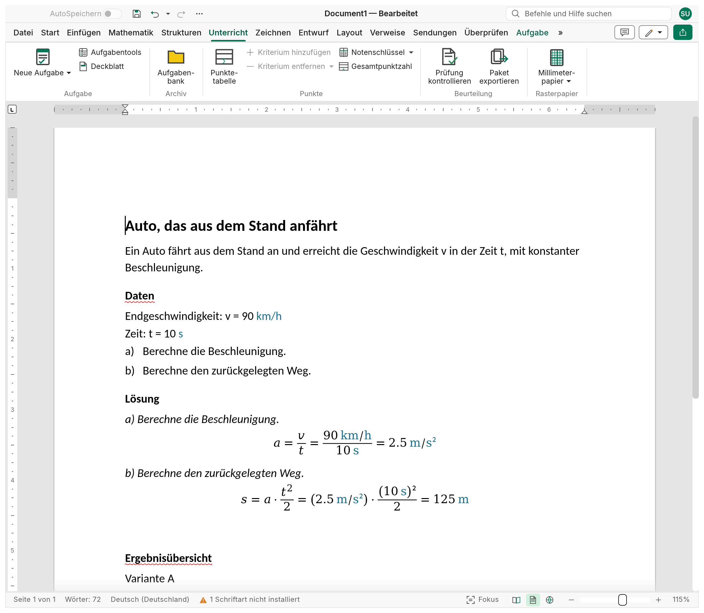
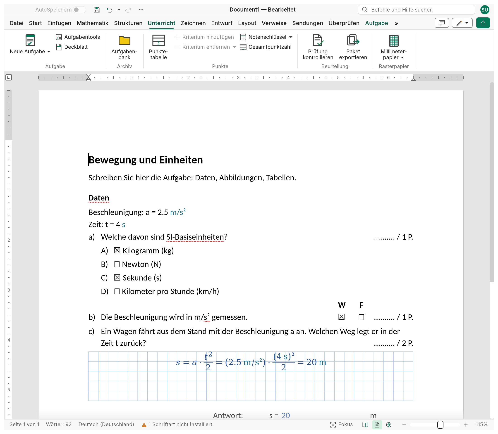
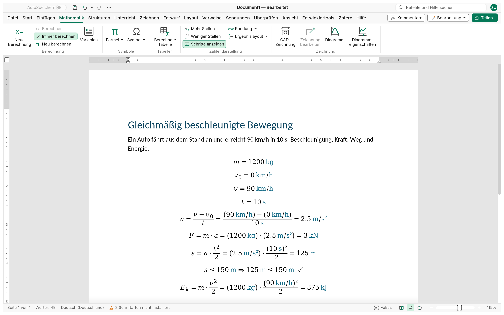
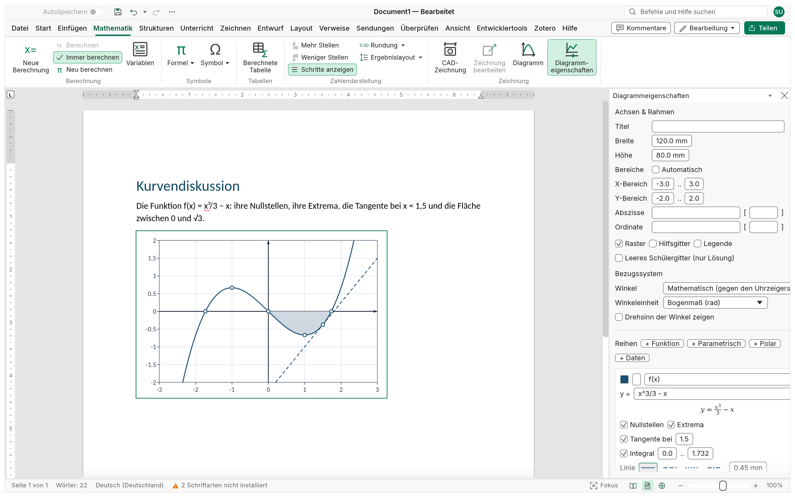
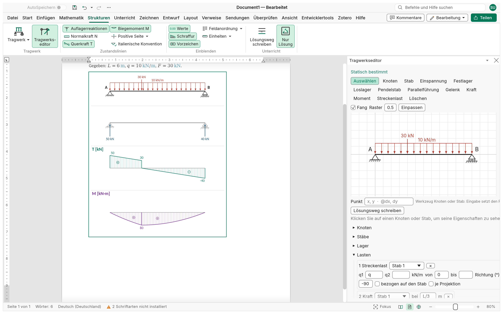

<p align="center">
  
</p>

<h1 align="center">Strix</h1>

<p align="center">
  <b>Klassenarbeiten und Übungen für Lehrkräfte: Schreib die Klassenarbeit, Lösungen und Punkte führt Strix.</b>
</p>

<p align="center">
  Strix ist ein quelloffener Editor, komplett in Rust geschrieben, um Klassenarbeiten
  vorzubereiten. Rechenaufgaben halten Angaben, Lösung und Ergebnisse lebendig, mit Varianten A,
  B, C für jede Bankreihe; Multiple-Choice-, Richtig/Falsch- und offene Fragen tragen ihre Punkte;
  eine Datei pro Aufgabe ergibt eine Sammlung, aus der die Klassenarbeit entsteht, mit oder ohne
  Lösungen. Eine Punktetabelle summiert selbst nach Kriterien, und ein Notenschlüssel rechnet die
  Punkte in Noten um. Darunter rechnen die Gleichungen auf der Seite, mit Einheiten, und
  Diagramme, CAD-Zeichnungen und ebene Tragwerke folgen ihnen. Nativ unter Windows, macOS, Linux
  und BSD, und im Browser per WebAssembly.
</p>

<p align="center">
  <a href="https://nabre.github.io/strix/de/"><b>Website</b></a> ·
  <a href="https://github.com/nabre/strix/releases/latest"><b>Download</b></a> ·
  <a href="https://nabre.github.io/strix/app/?sample"><b>Im Browser ausprobieren</b></a> ·
  <a href="https://github.com/nabre/strix/issues"><b>Problem melden</b></a>
</p>

<p align="center"><a href="../README.md">English</a> · <a href="README.it.md">Italiano</a> · <a href="README.fr.md">Français</a> · Deutsch</p>

> **Status: Alpha.** Der Dokumenteditor, auf dem Strix aufbaut, ist ausgereift; Rechenkern, Aufgaben,
> CAD, Diagramme und Tragwerke sind neu und entwickeln sich schnell. Bewahre eine Kopie wichtiger Dokumente auf und
> [sag uns, was nicht funktioniert](https://github.com/nabre/strix/issues). Das englische README
> ist die vollständige Referenz.

## Rechenaufgaben

**Unterricht › Aufgabe › Neue Aufgabe** fügt eine gelöste Aufgabe ein, deren Struktur beim Bearbeiten
nicht zerbricht: Titel, Aufgabentext, **Angaben** (Symbol, Beschreibung, Wert, Einheit), Fragen
mit Buchstaben auf drei Ebenen (a), a.1), a.1.1)); die **Lösung** wiederholt jede Frage
schreibgeschützt mit Platz für den Lösungsweg; eine **Ergebnisübersicht** am Dokumentende
(`a) a = 2.5 m/s²`).

Die Lösung ist eine lebendige Berechnung (siehe [WYSIWYG-Mathematik](#wysiwyg-mathematik)): Die
Angaben können **Varianten** A, B, C… haben, und die Wahl einer Variante berechnet Angaben, Lösung
und Übersicht neu; jede Bankreihe bekommt ihre eigenen Zahlen, keine Lösung wird von Hand neu
gerechnet. Jede Aufgabe ist eine **Sandbox** (zwei Aufgaben können beide `t` definieren); nach den
Fragen kann Karopapier folgen, und eine CAD-Zeichnung, ein [Diagramm](#diagramme) oder ein
[Tragwerk](#ebene-tragwerke) im Aufgabentext folgt den Angaben.

Steht der Cursor in einer Aufgabe, erscheint neben den anderen der Reiter **Aufgabe** mit Fragen,
Varianten und Layout; **Frageneinstellungen** (Typ und Punkte jeder Frage) und **Daten** (eine
Gleichung pro Angabe, `L = 4.5 m`, mit den Varianten als Schaltflächen) öffnen sich als Bereiche
neben dem Dokument. **Varianten generieren** erzeugt neue Varianten aus Listen oder Bereichen von
Werten und behält nur die mit sauberen Ergebnissen (wenige Nachkommastellen, positiv, alle
verschieden), und jede Variante wird beim Schreiben geprüft: Eine, deren Rechnung scheitert
(Einheiten, die nicht zusammenpassen, die Wurzel einer negativen Zahl), wird sofort markiert.

<p align="center">
  <picture>
    <source media="(prefers-color-scheme: dark)" srcset="../site/shots/de/shot-exercise-dark.png">
    
  </picture>
</p>

## Multiple Choice und offene Fragen

Eine Aufgabe kann auch ein Quiz sein, und jede Frage hat ihren eigenen Modus, sodass ein Quiz sie
mischt ([question-modes.md](question-modes.md), auf Englisch):

| Modus | Kopie der Schüler | Korrigierte Kopie |
|---|---|---|
| **Offene Antwort** | ein Antwortfeld mit Höhe in cm, kariert oder leer | die Antwort im Feld |
| **Multiple Choice** | Optionen A), B), C)… mit leeren Kästchen | die richtigen Kästchen angekreuzt (auch mehrere) |
| **Richtig/Falsch** | *Richtig* und *Falsch* mit leeren Kästchen | das richtige angekreuzt |
| **Rechnung** | ein kariertes Feld für den Lösungsweg, dann `Antwort: s = ______ m` | der Lösungsweg als lebendige Gleichungen und `Antwort: s = 20 m` |
| **CAD-Zeichnung** | ein kariertes Feld zum Zeichnen, oder eine Figur zum Vervollständigen | die CAD-Zeichnung der Lösung, oder die vervollständigte Figur |
| **Lückentext** | ein Text mit einer Schreiblinie für jedes ausgeblendete Wort (oder jeden berechneten Wert) | die ausgeblendeten Wörter, in der Formatvorlage *Ausgeblendetes Wort* |
| **Zuordnung** | zwei Spalten, die rechte gemischt, mit Kästchen für die Buchstaben | die Buchstaben der richtigen Paare |
| **Durchgerechnetes Beispiel** | das Beispiel mit seiner Lösung, immer sichtbar, ohne Punkte | dasselbe |

Die richtigen Antworten werden **mit der Lösung ausgeblendet**: Die Kästchen bleiben leer, die
Felder behalten ihre Höhe, so ist die Kopie der Schüler genauso gesetzt wie die der Lehrkraft.
Jede Frage hat ihre **Punkte**, daneben angezeigt und in der Punktetabelle summiert. Die
**Aufgabe** (Text, Angaben, Fragen, Lösung) bleibt die Art für lange, mehrstufige Aufgaben.

<p align="center">
  <picture>
    <source media="(prefers-color-scheme: dark)" srcset="../site/shots/de/shot-quiz-dark.png">
    
  </picture>
</p>

## Von der Aufgabensammlung zur Klassenarbeit

- **Eine Datei pro Aufgabe** ergibt eine Sammlung; jede Datei trägt ihre **Archiveigenschaften**
  (Klasse, Zug, Fach, Lehrkraft, Dauer, Themen, Punktzahl), auch in Word sichtbar. Der Bereich
  **Aufgabenbank** (Unterricht › Archiv) durchsucht einen Ordner mit Aufgaben nach Eigenschaften
  und Text und fügt eine als Kopie oder als verknüpftes Filialdokument ein
  ([archive.md](archive.md)).
- Ein **Masterdokument** stellt daraus die Klassenarbeit zusammen, mit eigener Nummerierung,
  Deckblatt, Seitenumbrüchen und gezeigten Teilen (mit oder ohne Lösungen und Ergebnisse);
  **die Dateien der Sammlung ändern sich nie** ([master-documents.md](master-documents.md)).
- Die **DSA-Formatierung** (Gruppe **LRS** im Reiter Entwurf; Lernschwierigkeiten: Lesen,
  Schreiben, Rechnen und Gedächtnis, kombinierbar, Seite immer weiß) passt dieselbe Klassenarbeit
  an ([dsa.md](dsa.md)).
- **Prüfung kontrollieren** (Unterricht › Beurteilung) sieht die Klassenarbeit vor dem Druck
  durch: alle Varianten, die richtigen Antworten, fehlende Lösungen, die Punkte und ihre Summen,
  die Antwortfelder, die Dauer und die Seitenzahl jeder Variante, jedes Problem einen Klick
  entfernt.
- **Prüfungspaket exportieren** (Unterricht › Beurteilung) schreibt in einem Schritt das
  Schüler-PDF jeder Variante, ihre DSA-Fassung und den Lehrerschlüssel mit den ausgearbeiteten
  Lösungen, dem Notenschlüssel und einer Tabelle der Ergebnisse aller Varianten.
- **PDF**-Export zum Drucken.

## Punkte und Noten

Die **Punktetabelle** (Unterricht › Punkte › Punktetabelle) hat eine Zeile pro Aufgabe und zwei
Spalten pro Kriterium (die auf dem Blatt vergebenen Punkte und die, die die Aufgabe wert ist); die
**Summen** je Zeile und Spalte folgen beim Tippen, und die Gesamtsumme ist die Eigenschaft
**Punktzahl** der Datei.

Der **Notenschlüssel** (Unterricht › Punkte › Notenschlüssel) rechnet die Punkte in Noten um:
eine Tabelle mit einer Zeile pro Note, von der niedrigsten zur höchsten in der gewählten
Schrittweite (etwa 1–10 in halben Schritten), und den Punkten, die sie ergeben, als Intervall
`[12; 14[`. Er beginnt mit einer Schulvorgabe (Italien 1–10, Schweiz 1–6, Deutschland 6–1,
Frankreich 0–20, Prozent) oder einer eigenen: die Bestehensgrenze und ihre Note, eine Gerade oder
zwei, die Punkte auf ein Vielfaches gerundet (0,25, 0,5), das Maximum aus der Punktetabelle oder
fest, und ob die Schüler ihn sehen. **Eigenschaften des Notenschlüssels** öffnet sich neben dem
Dokument mit einer Vorschau, bestandene Noten in Grün. Details (auf Englisch):
[exercise.md](exercise.md).

## WYSIWYG-Mathematik

Kein separates Rechenblatt, keine Codezellen, keine Formelleiste. Eine Gleichung im Dokument *ist*
die Berechnung: an Ort und Stelle mit dem Formeleditor getippt und als gesetzte Mathematik
angezeigt. Strix liest die berechneten Gleichungen in Lesereihenfolge und hält die Ergebnisse
aktuell: nach jeder Änderung (sobald der Cursor die Gleichung verlässt), mit F9 und beim Öffnen.

```text
m = 1200 kg                        definiert m
v_0 = 0 km/h
v = 90 km/h                        Einheiten rechnen sich selbst um: km/h, s, m/s
t = 10 s
a = (v − v_0)/t =                  →  a = (v − v₀)/t = 2.5 m/s²
F = m·a =                          →  F = m·a = 3 kN
s = a·t²/2 =                       →  s = a·t²/2 = 125 m
s ≤ 150 m                          →  s ≤ 150 m ⇒ 125 m ≤ 150 m ✓
E_k = m·v²/2 = kJ                  →  E_k = m·v²/2 = 375 kJ        (die Einheit nach =)
v² = 2·a·d                         →  v² = 2·a·d ⇒ d = 125 m         (d ist die einzige Unbekannte: gelöst)
```

<p align="center">
  <picture>
    <source media="(prefers-color-scheme: dark)" srcset="../site/shots/de/shot-calc-dark.png">
    
  </picture>
</p>

- **Ein `=` für alles**: Definition, anzuzeigendes Ergebnis (auch in einer gewählten Einheit,
  `E_k = kJ`), Formel mit Wert, Gleichung, die nach ihrer einen Unbekannten **gelöst** wird, oder
  **Nachweis** (`≤ ≥ < > ≠` mit ✓/✗).
- **Lösen**: Die Unbekannte wird symbolisch freigestellt, wenn sie einmal vorkommt, sonst
  numerisch gefunden.
- **Einheiten überall**: SI mit Präfixen, technische Einheiten (`mm`, `kN`, `MPa`, `bar`, `kWh`…),
  dimensionslose Einheiten bleiben (`%`, `‰`, `°`, `rad`). Dimensionsfehler (`2 m + 3 s`) werden
  gemeldet, nie still verrechnet. Die Arbeitseinheit folgt dem, was du schreibst; eine falsch
  geschriebene Einheit bekommt einen Hinweis („meintest du kN?“).
- **Lösungsschritte**, **berechnete Tabellen** (Spalten mit Einheiten und Formeln, etwa
  `ρ [g/cm³] = m/V` für Messreihen im Labor, und `Σ =`, `mean =`, `min =`, `max =`), **Summen, Bereiche und Vektoren**, **Zahlenformat**.
- **Ableitungen, Integrale und Grenzwerte**: `f′(a)` und `f″(a)` einer selbst definierten
  Funktion (`f(x) = …`), bestimmte Integrale `∫_a^b f(x) dx` mit Einheiten, links- und
  rechtsseitige Grenzwerte, Binomialsummen; die Strukturen des Formeleditors (Betrag, Wurzeln mit
  Wurzelexponent, Logarithmen zur Basis, Fallunterscheidungen, Determinanten) werden als
  Berechnungen gelesen. `°C` und `°F` rechnen sich als Temperaturen und als Differenzen um.
- **Der Variablenbereich** (Mathematik › Berechnung › Variablen) listet jeden bis dahin
  definierten Namen mit seinem Wert und rechnet Einheiten um.
- **Fehler halten das Blatt nicht an**: Eine fehlerhafte Anweisung zeigt `⚠` und ihre Meldung.

Das Rechnen liegt im Reiter **Mathematik** (mit Berechnete Tabelle, die einen eigenen Reiter
bekommt, solange der Cursor in einer Tabelle steht, dem Zahlenformat, CAD-Zeichnung und
Diagramm); Tragwerke haben den Reiter **Strukturen**; Aufgaben, Punkte, Notenschlüssel und
Karopapier liegen im Reiter **Unterricht**. Details (auf Englisch): [calc.md](calc.md).

## CAD-Zeichnungen, die den Berechnungen folgen

**Einfügen › CAD-Zeichnung** setzt eine technische Zeichnung in den Text. Koordinaten, Radien und
Winkel können **Ausdrücke der Parameter** sein (`["b", 0]`, `b/2`): Ändere `b = 6 cm`, und das
Dreieck wird neu gezeichnet, jede Variante hat also ihre Figur; Bemaßungen rufen Parameter ab
(`{{b}}` zeigt `6 cm`). Der Editor auf dem Zeichenblatt, mit eigenen Reitern (**CAD-Zeichnung**,
**CAD-Beschriftung**, **CAD-Ausgabe**), hat eine Befehlszeile für Koordinaten, **exakte
Objektfänge** auf den echten Kurven, Griffe, die die Ausdrücke behalten, ausgerichtete,
horizontale, vertikale und Winkelbemaßungen, Schraffuren und die Änderungswerkzeuge (Schieben,
Kopieren, Drehen, Skalieren, Spiegeln, Versatz, Stutzen, Dehnen, Abrunden, Fasen, Reihen), jedes
mit einer Vorschau vor dem Klick; dazu einen Eigenschaftenbereich und Layer. Die Zeichnung wird als
JSON in der Datei gespeichert, zusammen mit einem SVG-Bild. *Geplant:* Bemaßungen, die die
Zeichnung steuern, mit geometrischen Abhängigkeiten. Details: [cad.md](cad.md).

## Diagramme

**Mathematik › Zeichnung › Diagramm** zeichnet ein lebendiges kartesisches Diagramm in den Text,
aus den Berechnungen davor ([plot.md](plot.md), auf Englisch): Funktionen `y = f(x)` (Pole und
Asymptoten nie verbunden), Parameter- und Polarkurven, Messwerte aus einer berechneten Tabelle mit
Fehlerbalken und einer linearen oder quadratischen Regression mit R². Eine Funktion kann ihre
**Nullstellen**, **Extrema**, eine **Tangente** und ein schraffiertes **Integral** zeigen;
**Analyse in Dokument einfügen** schreibt sie nach dem Diagramm als lebendige Berechnungen. Die
Achsen tragen ihre Namen an den Pfeilen, und diese Namen sind die Variablen der Formeln; die
Bereiche passen sich dem an, was zu zeigen ist; Winkel laufen mathematisch oder geodätisch, in
rad, ° oder gon. Ändere einen Parameter, und das Diagramm zeichnet sich neu; in der Kopie der
Schüler lässt ein als Lösung markiertes Diagramm (oder eine einzelne Kurve) ein leeres,
beschriftetes Raster gleicher Größe stehen. Der Bereich **Diagrammeigenschaften** bearbeitet jede
Datenreihe.

<p align="center">
  <picture>
    <source media="(prefers-color-scheme: dark)" srcset="../site/shots/de/shot-plot-dark.png">
    
  </picture>
</p>

## Ebene Tragwerke

Der Reiter **Strukturen** (zwischen Mathematik und Unterricht) fügt einen **Träger, Rahmen oder
ein Fachwerk** ein, das an Ort und Stelle berechnet und wie im Lehrbuch gezeichnet wird
([structures.md](structures.md), auf Englisch): das Tragwerk mit Lagern und Lasten, die
**Auflagerreaktionen** und die **Zustandslinien** von Normalkraft, Querkraft und Biegemoment
untereinander im selben Maßstab, schraffiert, mit ⊕/⊖ und den maßgebenden Werten; ein Fachwerk
zeigt die Stabkraft jedes Stabs, Zug und Druck in zwei Farben. Jede Last hat ihren Namen (`F_1`,
`q_2`, `C_3`), die Zeichnung trägt die **Bemaßung** des Tragwerks, die Neigungen und die Winkel
der Kräfte, und die Zustandslinien markieren ihre **Stationen** (wo ein maßgebender Wert liegt,
gemessen vom Stabanfang). Die Zustandslinien heißen
standardmäßig N, T und M; den Titel der Querkraft kann man pro Tragwerk ändern, etwa in Q.

- **Jedes ebene Tragwerk**: Einspannungen, Festlager, Loslager, Pendelstäbe und
  Parallelführungen unter beliebigem Winkel, innere Gelenke; Kräfte, Momente und Streckenlasten,
  konstant, dreieck- oder trapezförmig, in globalen oder lokalen Achsen, je Länge oder je
  Projektion. Es wird als statisch bestimmt, *h*-fach statisch unbestimmt oder kinematisch
  eingestuft und mit dem Weggrößenverfahren berechnet.
- **Von den Berechnungen gesteuert**: Jede Länge und jede Last kann ein Parameter sein (`L`,
  `q`), so hat jede Variante einer Aufgabe ihr eigenes Tragwerk und ihre eigenen Zustandslinien;
  die italienische Konvention (Moment auf der Seite der gezogenen Faser) ist voreingestellt, und
  die positive Seite jeder Zustandslinie ist wählbar.
- **Der Tragwerkseditor**: Ein Doppelklick auf ein Tragwerk öffnet es anstelle der Seite, mit
  einem eigenen Menüband-Reiter: ein Blatt mit Raster und Fang, Werkzeuge für Knoten, Stäbe,
  Lager, Gelenke und Lasten, Auswahl per Klick und Fenster, Griffe zum Verschieben von Knoten,
  Versetzen und Drehen von Lasten und Strecken von Streckenlasten, ein Kontextmenü (Stäbe teilen
  oder verbinden, Lager, Gelenke, Lasten), eingetippte Koordinaten, die Eigenschaften der Auswahl
  und Tabellen der Knoten, Stäbe, Lager und Lasten.
- **Der geschriebene Lösungsweg**: **Lösungsweg schreiben** setzt die Lösung als lebendige
  Berechnungen hinter das Tragwerk: zuerst die Lasten, ihre Resultierenden und Komponenten und der
  Hebelarm jeder Kraft, dann die Gleichgewichtsbedingungen in allgemeiner Form
  (`0 kN·m = V_B·6 m − F_1·d_(1,A)`), jede mit ihren Schritten nach ihrer Auflagerreaktion
  aufgelöst, dann die Verläufe jedes Stabs (`T_1(x) = V_A − q_1·x`) Abschnitt für Abschnitt, mit
  ihren Werten an den Enden und den Extrema des Moments. Der Lösungsweg folgt dem Tragwerk: Jede
  Änderung daran oder an einem Parameter, den es liest, schreibt ihn neu.
- **Eine Aufgabe zum Tragwerk**: **Tragwerksaufgabe** schreibt eine ganze Aufgabe (das Tragwerk im
  Aufgabentext; Auflagerreaktionen, N, T, wo T null wird, das größte Moment dort, M), jede Antwort
  mit ihrem Lösungsweg und ihrer eigenen Zeichnung; **Zur Aufgabe** und **Zum Tragwerk** wandeln
  ein Tragwerk an Ort und Stelle zwischen technischem Bericht und Aufgabe um.
- In der Kopie der Schüler lässt **Nur Lösung** Auflagerreaktionen und Zustandslinien weg und
  behält die leeren Felder, so haben beide Kopien dasselbe Layout.

<p align="center">
  <picture>
    <source media="(prefers-color-scheme: dark)" srcset="../site/shots/de/shot-structure-dark.png">
    
  </picture>
</p>

## Karopapier

**Einfügen › Rasterpapier** kariert die Seite oder einen Block im Text wie ein Rechenheft, mit einer
kräftigeren Linie alle N Kästchen, scharf bei jedem Zoom und im PDF. Details: [graph-paper.md](graph-paper.md).

## Ein vollständiger Dokumenteditor

Darunter steckt eine echte Textverarbeitung (Strix ist ein Fork von WordCraft): Menüband,
Formatvorlagen, Listen, Tabellen, Bilder und Formen, Kopf- und Fußzeilen, Abschnitte und Spalten,
Fußnoten, Zitate und Inhaltsverzeichnisse, Kommentare und Änderungsverfolgung, Rechtschreibung und
Silbentrennung, Serienbriefe und Druck. Die Oberfläche folgt der Systemsprache (Deutsch,
Englisch, Italienisch oder Französisch).

## Dateien

| | Formate |
|---|---|
| **Speichert** | `.xmath` (Dokument) und `.xmathm` (Vorlage), und Words `.docx`, `.docm`, `.dotx`, `.dotm`: alle halten Berechnungen, Aufgaben, Zeichnungen, Diagramme und Tragwerke lebendig |
| **Speichert zurück** (Dokumente ohne Strix-Objekte) | `.odt`, `.rtf`, `.txt`, Word XML |
| **Exportiert** (statische Kopien) | PDF, PNG, LaTeX, HTML, Markdown |
| **Öffnet** | `.xmath`, `.xmathm`, `.docx`, `.docm`, `.dotx`, `.dotm`, `.doc`, `.odt`, `.rtf`, `.md`, `.html`, `.tex`, `.txt`, Word XML |

Ein neues Dokument ist eine `.xmath`, und wie Word speichert Strix eine Datei im Format zurück,
aus dem sie kommt. **Word-Dateien behalten Strix-Objekte auch über Word hinweg**: Eine von Strix
geschriebene `.docx` trägt jede Berechnung, berechnete Tabelle, Aufgabe, CAD-Zeichnung, jedes
Diagramm, Tragwerk und Karopapier ein zweites Mal, in Inhaltssteuerelementen und einem
benutzerdefinierten XML-Teil, den Word beim Speichern behält. Öffne die Datei in Word, bearbeite
den Text drumherum, speichere, und in Strix sind die Objekte wieder lebendig; eines, das in Word
geändert wurde, bleibt, wie Word es hinterlassen hat, und wartet auf deine Entscheidung
([word-round-trip.md](word-round-trip.md), auf Englisch). Die anderen bearbeitbaren Formate (ODT,
RTF, reiner Text, Word XML) behielten nur ihr letztes Aussehen, deshalb wird ein Dokument mit
solchen Objekten nicht in diesen Formaten gespeichert: Speichern schlägt eine `.xmath` vor und
nennt, was verloren ginge („3 Berechnungen, 1 CAD-Zeichnung“), Speichern unter lässt diese Formate
weg, und `file.save`, `strix-cli convert` und MCP `save_document` lehnen mit derselben Erklärung
ab. Exporte (PDF, PNG, LaTeX, HTML, Markdown) sind Kopien und gehen immer. Eine `.xmath`-Datei
bleibt ein Standardpaket: Andere Programme zeigen die zuletzt berechneten Werte.

## Für Agenten: Befehle, CLI, MCP

Alles, was Strix tut, ist ein **Befehl** in einem einzigen Register. Menüband, Tastenkürzel,
Befehlssuche, Kommandozeile, Steuerkanal und MCP-Server führen dieselben Befehle aus, und
programmatische Aufrufe öffnen nie Dialoge. Zu den Befehlen für Unterricht, Berechnung und
Zeichnung gehören `exercise.insert`, `exercise.setData`, `exercise.variant`,
`exercise.generateVariants`, `exercise.scores`, `exercise.grading`, `exercise.check`,
`file.exportPack`, `design.dsa`, `calc.insert`, `table.calc`, `insert.cad`, `plot.insert`,
`plot.analysis`, `structure.insert`, `structure.working`, `structure.exercise` und
`structure.mode`: Ein Agent kann eine ganze
Klassenarbeit vorbereiten, mit ihren Varianten, ihrem Notenschlüssel und den Kopien zum Drucken.

```sh
claude mcp add strix -- strix-cli mcp                      # Dokumente ohne Oberfläche
strix --control 7981 &                                     # oder die laufende App steuern
claude mcp add strix-app -- strix-cli mcp --connect 127.0.0.1:7981
```

Siehe [mcp.md](mcp.md) und das [Steuerprotokoll](control-protocol.md).

## Download

Installer und portable Versionen gibt es auf der [Release-Seite](https://github.com/nabre/strix/releases)
und auf der [Website](https://nabre.github.io/strix/de/#download): Windows (MSI, portables ZIP und portable EXE, die ihre Einstellungen in einem Ordner
`StrixData` daneben speichert;
x64, x86, ARM64), macOS (Universal-DMG), Linux (AppImage, deb, rpm, Flatpak, Arch; x86_64 und
aarch64, dazu riscv64), FreeBSD und der Web-Build. Die Signierung der Windows-Builds (SignPath
Foundation) wird eingerichtet. Datenschutz: Strix prüft beim Start und einmal täglich, ob es eine
neue Version gibt (Datei › Info), sonst nichts: keine Telemetrie, kein Konto; Details in
[code-signing.md](code-signing.md) und [updates.md](updates.md).

## Bauen und starten

Du brauchst eine Rust-Toolchain (1.95 oder neuer); für den Web-Build zusätzlich
[Trunk](https://trunkrs.dev/) und das Ziel `wasm32-unknown-unknown`.

```sh
git clone https://github.com/nabre/strix
cd strix
cargo run --release -p strix -- --sample          # die Desktop-App mit der Beispiel-Klassenarbeit
cargo xtask dev                                   # Debug-Build, bei jeder Änderung neu gebaut und neu gestartet (watchexec)
                                                  # ohne Bildschirm (Sandbox, SSH) oder --web: Web-Build auf http://127.0.0.1:8771/?sample
cargo run --release -p strix -- aufgabe.xmath     # ein Strix-Dokument öffnen
strix-cli convert aufgabe.xmath aufgabe.pdf       # statischer Export: pdf, png, tex, html, md
```

Web: `cd apps/strix-web && trunk serve`, dann <http://127.0.0.1:8771/?sample> öffnen.

## Stand und Roadmap

Fertig: Berechnungen mit einem `=` und Einheiten, Ableitungen, Integrale und Grenzwerte,
berechnete Tabellen, Aufgaben mit Angaben und Varianten (generiert und geprüft), Quiz mit allen
Fragemodi, Klassenarbeiten aus der Aufgabensammlung über Masterdokumente, DSA-Formatierung,
Kontrolle vor dem Druck und Export des Prüfungspakets, Punktetabelle und Notenschlüssel,
Karopapier, parametrische CAD-Zeichnungen mit den Änderungswerkzeugen, Diagramme mit ihrer
Analyse, ebene Tragwerke mit ihrem Lösungsweg und ihren Aufgaben, Word-Dateien, die Strix-Objekte behalten. Als
Nächstes notiert: Gleichungssysteme und Matrizen, eine Ergebnistabelle pro Aufgabe und eine
Übersicht pro Variante, Fragen zum Ordnen, CAD-Bemaßungen, die die Zeichnung steuern. Details in
[ROADMAP.md](../ROADMAP.md) (mit dem
Fortschrittsprotokoll). Der Dokumenteditor folgt der
[Roadmap von WordCraft](https://github.com/storytold/wordcraft/blob/main/ROADMAP.md).

## Lizenz und Dank

Strix steht wahlweise unter der [MIT](../LICENSE-MIT)- oder der [Apache-2.0](../LICENSE-APACHE)-Lizenz.
Copyright (c) 2026 nabre und die Strix-Mitwirkenden. Strix ist ein Fork von
[WordCraft](https://github.com/storytold/wordcraft), weder mit dessen Autoren verbunden noch von
ihnen unterstützt; die erforderlichen Hinweise stehen in [NOTICE](../NOTICE). Mitgelieferte
Schriften, Symbole, Wörterbücher und Übersetzungen behalten ihre offenen Lizenzen, aufgeführt in
[ATTRIBUTION.md](../ATTRIBUTION.md). Microsoft und Word sind Marken der Microsoft Corporation;
Strix ist ein unabhängiges Projekt, weder mit Microsoft verbunden noch von Microsoft unterstützt
oder gesponsert, und liest und schreibt Word-Dateien nach den veröffentlichten Spezifikationen
(ECMA-376, ISO/IEC 29500).
