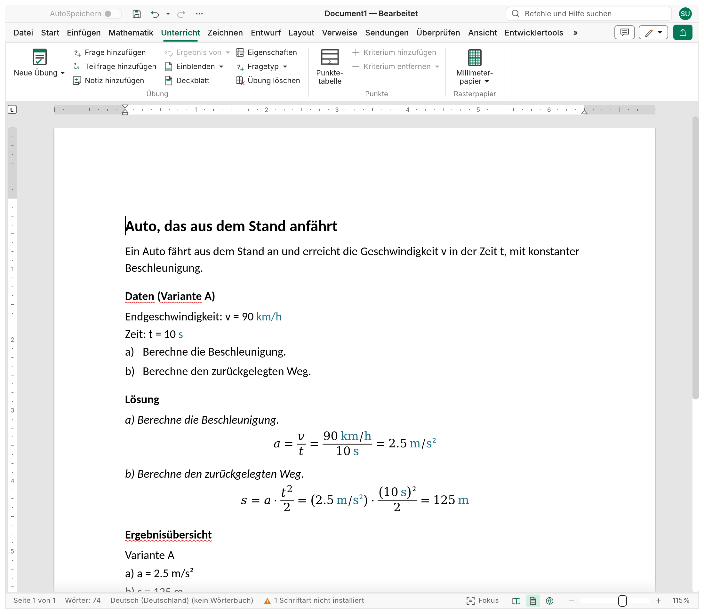
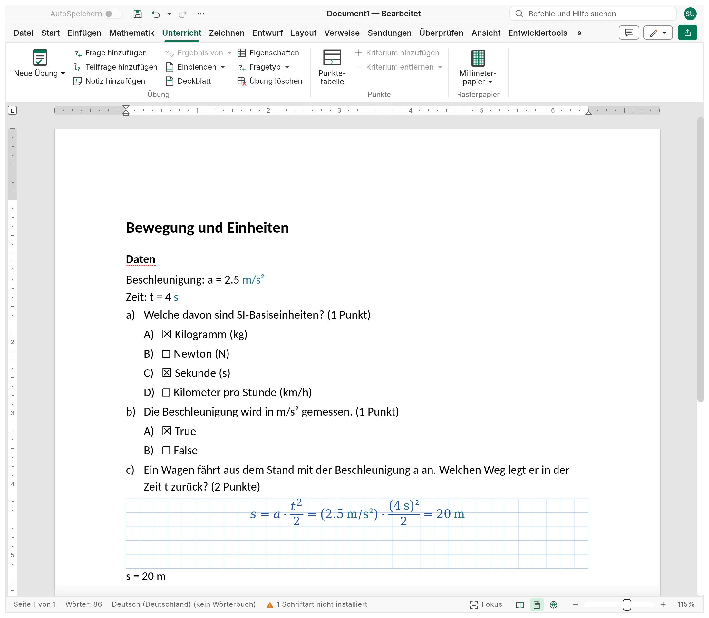
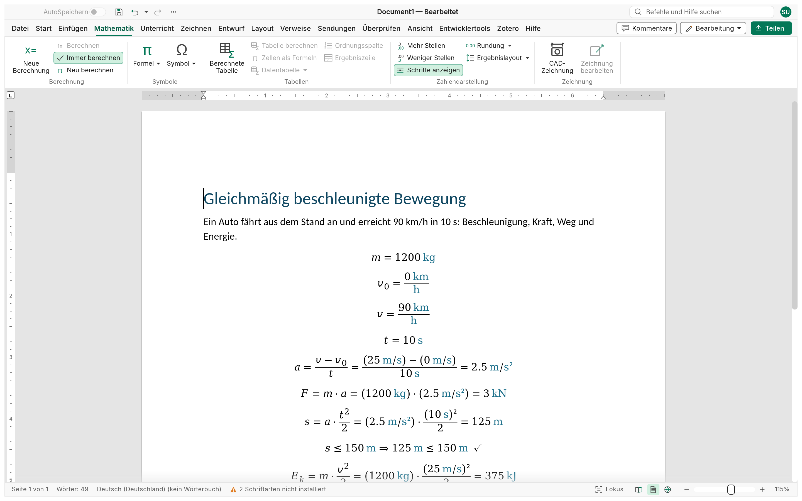

<p align="center">
  
</p>

<h1 align="center">Strix</h1>

<p align="center">
  <b>Klassenarbeiten und Übungen für Lehrkräfte: Schreib die Klassenarbeit, Lösungen und Punkte führt Strix.</b>
</p>

<p align="center">
  Strix ist ein quelloffener Editor, komplett in Rust geschrieben, um Klassenarbeiten
  vorzubereiten. Rechenaufgaben halten Angaben, Lösung und Ergebnisse lebendig, mit Varianten A,
  B, C für jede Bankreihe; Multiple-Choice-, Richtig/Falsch- und offene Fragen tragen ihre Punkte;
  eine Datei pro Aufgabe ergibt eine Sammlung, aus der die Klassenarbeit entsteht, mit oder ohne
  Lösungen. Eine Punktetabelle summiert selbst nach Kriterien; ein Notenschlüssel, der Punkte in
  Noten umrechnet, ist geplant. Darunter rechnen die Gleichungen auf der Seite, mit Einheiten.
  Nativ unter Windows, macOS, Linux und BSD, und im Browser per WebAssembly.
</p>

<p align="center">
  <a href="https://nabre.github.io/strix/de/"><b>Website</b></a> ·
  <a href="https://github.com/nabre/strix/releases/latest"><b>Download</b></a> ·
  <a href="https://nabre.github.io/strix/app/?sample"><b>Im Browser ausprobieren</b></a> ·
  <a href="https://github.com/nabre/strix/issues"><b>Problem melden</b></a>
</p>

<p align="center"><a href="../README.md">English</a> · <a href="README.it.md">Italiano</a> · <a href="README.fr.md">Français</a> · Deutsch</p>

> **Status: Alpha.** Der Dokumenteditor, auf dem Strix aufbaut, ist ausgereift; Rechenkern, Übungen
> und CAD sind neu und entwickeln sich schnell. Bewahre eine Kopie wichtiger Dokumente auf und
> [sag uns, was nicht funktioniert](https://github.com/nabre/strix/issues). Das englische README
> ist die vollständige Referenz.

## Rechenaufgaben

**Unterricht › Übung › Neue Übung** fügt eine gelöste Aufgabe ein, deren Struktur beim Bearbeiten
nicht zerbricht: Titel, Aufgabentext, **Angaben** (Symbol, Beschreibung, Wert, Einheit), Fragen
mit Buchstaben auf drei Ebenen (a), a.1), a.1.1)); die **Lösung** wiederholt jede Frage
schreibgeschützt mit Platz für den Lösungsweg; eine **Ergebnisübersicht** am Dokumentende
(`a) a = 2.5 m/s²`).

Die Lösung ist eine lebendige Berechnung (siehe [WYSIWYG-Mathematik](#wysiwyg-mathematik)): Die
Angaben können **Varianten** A, B, C… haben, und die Wahl einer Variante berechnet Angaben, Lösung
und Übersicht neu; jede Bankreihe bekommt ihre eigenen Zahlen, keine Lösung wird von Hand neu
gerechnet. Jede Übung ist eine **Sandbox** (zwei Übungen können beide `t` definieren); nach den
Fragen kann Karopapier folgen, und eine CAD-Zeichnung im Aufgabentext folgt den Angaben.

<p align="center">
  <picture>
    <source media="(prefers-color-scheme: dark)" srcset="../site/shots/de/shot-exercise-dark.png">
    
  </picture>
</p>

## Multiple Choice und offene Fragen

Eine Übung kann auch ein Quiz sein, und jede Frage hat ihren eigenen Modus, sodass ein Quiz sie
mischt ([question-modes.md](question-modes.md), auf Englisch):

| Modus | Kopie der Schüler | Korrigierte Kopie |
|---|---|---|
| **Offene Antwort** | ein Antwortfeld mit Höhe in cm, kariert oder leer | die Antwort im Feld |
| **Multiple Choice** | Optionen A), B), C)… mit leeren Kästchen | die richtigen Kästchen angekreuzt (auch mehrere) |
| **Richtig/Falsch** | *Richtig* und *Falsch* mit leeren Kästchen | das richtige angekreuzt |
| **Rechnung** | ein kariertes Feld für den Lösungsweg, dann `s = ______ m` | der Lösungsweg als lebendige Gleichungen und `s = 20 m` |
| **CAD-Zeichnung** | ein kariertes Feld zum Zeichnen | die CAD-Zeichnung der Lösung |

Die richtigen Antworten werden **mit der Lösung ausgeblendet**: Die Kästchen bleiben leer, die
Felder behalten ihre Höhe, so ist die Kopie der Schüler genauso gesetzt wie die der Lehrkraft.
Jede Frage hat ihre **Punkte**, daneben angezeigt und in der Punktetabelle summiert. Die
**Aufgabe** (Text, Angaben, Fragen, Lösung) bleibt die Art für lange, mehrstufige Übungen.

<p align="center">
  <picture>
    <source media="(prefers-color-scheme: dark)" srcset="../site/shots/de/shot-quiz-dark.png">
    
  </picture>
</p>

## Von der Aufgabensammlung zur Klassenarbeit

- **Eine Datei pro Aufgabe** ergibt eine Sammlung; jede Datei trägt ihre **Archiveigenschaften**
  (Klasse, Zug, Fach, Lehrkraft, Dauer, Punktzahl), auch in Word sichtbar
  ([archive.md](archive.md)).
- Ein **Masterdokument** stellt daraus die Klassenarbeit zusammen, mit eigener Nummerierung,
  Deckblatt, Seitenumbrüchen und gezeigten Teilen (mit oder ohne Lösungen und Ergebnisse);
  **die Dateien der Sammlung ändern sich nie** ([master-documents.md](master-documents.md)).
- Die **DSA-Formatierung** (Lernschwierigkeiten: Lesen, Schreiben, Rechnen und Gedächtnis,
  kombinierbar, Seite immer weiß) passt dieselbe Klassenarbeit an ([dsa.md](dsa.md)).
- **PDF**-Export zum Drucken.

## Punkte und Noten

Die **Punktetabelle** (Unterricht › Punkte › Punktetabelle) hat eine Zeile pro Übung und zwei
Spalten pro Kriterium (die auf dem Blatt vergebenen Punkte und die, die die Übung wert ist); die
**Summen** je Zeile und Spalte folgen beim Tippen, und die Gesamtsumme ist die Eigenschaft
**Punktzahl** der Datei.

*Geplant:* ein **Notenschlüssel**, der Punkte in Noten umrechnet (Schwellen, Skala, Rundung).
Details (auf Englisch): [exercise.md](exercise.md).

## WYSIWYG-Mathematik

Kein separates Rechenblatt, keine Codezellen, keine Formelleiste. Eine Gleichung im Dokument *ist*
die Berechnung: an Ort und Stelle mit dem Formeleditor getippt und als gesetzte Mathematik
angezeigt. Strix liest die berechneten Gleichungen in Lesereihenfolge und hält die Ergebnisse
aktuell: nach jeder Änderung (sobald der Cursor die Gleichung verlässt), mit F9 und beim Öffnen.

```text
m = 1200 kg                        definiert m
v_0 = 0 km/h
v = 90 km/h                        Einheiten rechnen sich selbst um: km/h, s, m/s
t = 10 s
a = (v − v_0)/t =                  →  a = (v − v₀)/t = 2.5 m/s²
F = m·a =                          →  F = m·a = 3 kN
s = a·t²/2 =                       →  s = a·t²/2 = 125 m
s ≤ 150 m                          →  s ≤ 150 m ⇒ 125 m ≤ 150 m ✓
E_k = m·v²/2 = kJ                  →  E_k = m·v²/2 = 375 kJ        (die Einheit nach =)
v² = 2·a·d                         →  v² = 2·a·d ⇒ d = 125 m         (d ist die einzige Unbekannte: gelöst)
```

<p align="center">
  <picture>
    <source media="(prefers-color-scheme: dark)" srcset="../site/shots/de/shot-calc-dark.png">
    
  </picture>
</p>

- **Ein `=` für alles**: Definition, anzuzeigendes Ergebnis (auch in einer gewählten Einheit,
  `E_k = kJ`), Formel mit Wert, Gleichung, die nach ihrer einen Unbekannten **gelöst** wird, oder
  **Nachweis** (`≤ ≥ < > ≠` mit ✓/✗).
- **Lösen**: Die Unbekannte wird symbolisch freigestellt, wenn sie einmal vorkommt, sonst
  numerisch gefunden.
- **Einheiten überall**: SI mit Präfixen, technische Einheiten (`mm`, `kN`, `MPa`, `bar`, `kWh`…),
  dimensionslose Einheiten bleiben (`%`, `‰`, `°`, `rad`). Dimensionsfehler (`2 m + 3 s`) werden
  gemeldet, nie still verrechnet. Die Arbeitseinheit folgt dem, was du schreibst; eine falsch
  geschriebene Einheit bekommt einen Hinweis („meintest du kN?“).
- **Lösungsschritte**, **berechnete Tabellen** (Spalten mit Einheiten und Formeln, etwa
  `ρ [g/cm³] = m/V` für Messreihen im Labor, und `Σ =`, `mean =`, `min =`, `max =`), **Summen, Bereiche und Vektoren**, **Zahlenformat**.
- **Fehler halten das Blatt nicht an**: Eine fehlerhafte Anweisung zeigt `⚠` und ihre Meldung.

Das Rechnen liegt im Reiter **Math**; Übungen, Punkte und Karopapier im Reiter **Unterricht**. Details (auf Englisch): [calc.md](calc.md).

## CAD-Zeichnungen, die den Berechnungen folgen

**Einfügen › CAD Drawing** setzt eine technische Zeichnung in den Text. Koordinaten, Radien und
Winkel können **Ausdrücke der Parameter** sein (`["b", 0]`, `b/2`): Ändere `b = 6 cm`, und das
Dreieck wird neu gezeichnet, jede Variante hat also ihre Figur; Bemaßungen rufen Parameter ab
(`{{b}}` zeigt `6 cm`). Der Editor
auf dem Zeichenblatt hat eine Befehlszeile für Koordinaten, **exakte Objektfänge** auf den echten
Kurven, Griffe, die die Ausdrücke behalten, einen Eigenschaftenbereich und Layer. Die Zeichnung
wird als JSON in der `.xmath`-Datei gespeichert, zusammen mit einem SVG-Bild. Details: [cad.md](cad.md).

## Karopapier

**Einfügen › Graph Paper** kariert die Seite oder einen Block im Text wie ein Rechenheft, mit einer
kräftigeren Linie alle N Kästchen, scharf bei jedem Zoom und im PDF. Details: [graph-paper.md](graph-paper.md).

## Ein vollständiger Dokumenteditor

Darunter steckt eine echte Textverarbeitung (Strix ist ein Fork von WordCraft): Menüband,
Formatvorlagen, Listen, Tabellen, Bilder und Formen, Kopf- und Fußzeilen, Abschnitte und Spalten,
Fußnoten, Zitate und Inhaltsverzeichnisse, Kommentare und Änderungsverfolgung, Rechtschreibung und
Silbentrennung, Serienbriefe und Druck. Die Oberfläche folgt der Systemsprache (Deutsch,
Englisch, Italienisch oder Französisch).

## Dateien

| | Formate |
|---|---|
| **Speichert** | `.xmath` (Dokument) und `.xmathm` (Vorlage): ein OOXML-Paket, das Berechnungen, Übungen und Zeichnungen lebendig hält |
| **Speichert zurück** (Dokumente ohne Strix-Objekte) | `.docx`, `.docm`, `.dotx`, `.dotm`, `.odt`, `.rtf`, `.txt`, Word XML |
| **Exportiert** (statische Kopien) | PDF, PNG, LaTeX, HTML, Markdown |
| **Öffnet** | `.docx`, `.docm`, `.dotx`, `.dotm`, `.doc`, `.odt`, `.rtf`, `.md`, `.html`, `.tex`, `.txt` |

Strix öffnet eine `.docx` (oder `.odt`, `.rtf`…) und speichert sie im selben Format zurück, solange
das Dokument keine **Strix-Objekte** enthält: Berechnungen, berechnete Tabellen, Übungen,
CAD-Zeichnungen oder Karopapier. Diese Formate verlören die lebendigen Berechnungen und die Quelle
der Zeichnungen; ein Dokument mit solchen Objekten speichert deshalb nur als `.xmath`: Speichern
schlägt eine `.xmath` gleichen Namens vor und nennt, was verloren ginge („3 Berechnungen,
1 CAD-Zeichnung“), Speichern unter lässt die verlustbehafteten Formate weg, und `file.save`,
`strix-cli convert` und MCP `save_document` lehnen mit derselben Erklärung ab. Exporte (PDF, PNG,
LaTeX, HTML, Markdown) sind Kopien und gehen immer. Eine `.xmath`-Datei bleibt ein Standardpaket:
Andere Programme zeigen die zuletzt berechneten Werte.

## Für Agenten: Befehle, CLI, MCP

Alles, was Strix tut, ist ein **Befehl** in einem einzigen Register. Menüband, Tastenkürzel,
Befehlssuche, Kommandozeile, Steuerkanal und MCP-Server führen dieselben Befehle aus, und
programmatische Aufrufe öffnen nie Dialoge.

```sh
claude mcp add strix -- strix-cli mcp                      # Dokumente ohne Oberfläche
strix --control 7981 &                                     # oder die laufende App steuern
claude mcp add strix-app -- strix-cli mcp --connect 127.0.0.1:7981
```

Siehe [mcp.md](mcp.md) und das [Steuerprotokoll](control-protocol.md).

## Download

Installer und portable Versionen gibt es auf der [Release-Seite](https://github.com/nabre/strix/releases)
und auf der [Website](https://nabre.github.io/strix/de/#download): Windows (MSI, portables ZIP und portable EXE, die ihre Einstellungen in einem Ordner
`StrixData` daneben speichert;
x64, x86, ARM64), macOS (Universal-DMG), Linux (AppImage, deb, rpm, Flatpak, Arch; x86_64 und
aarch64, dazu riscv64), FreeBSD und der Web-Build. Die Signierung der Windows-Builds (SignPath
Foundation) wird eingerichtet. Datenschutz: Strix prüft beim Start und einmal täglich, ob es eine
neue Version gibt (Datei › Info), sonst nichts: keine Telemetrie, kein Konto; Details in
[code-signing.md](code-signing.md) und [updates.md](updates.md).

## Bauen und starten

Du brauchst eine Rust-Toolchain (1.95 oder neuer); für den Web-Build zusätzlich
[Trunk](https://trunkrs.dev/) und das Ziel `wasm32-unknown-unknown`.

```sh
git clone https://github.com/nabre/strix
cd strix
cargo run --release -p strix -- --sample          # die Desktop-App mit einem Beispieldokument
cargo xtask dev                                   # Debug-Build, bei jeder Änderung neu gebaut und neu gestartet (watchexec)
                                                  # ohne Bildschirm (Sandbox, SSH) oder --web: Web-Build auf http://127.0.0.1:8771/?sample
cargo run --release -p strix -- aufgabe.xmath     # ein Strix-Dokument öffnen
strix-cli convert aufgabe.xmath aufgabe.pdf       # statischer Export: pdf, png, tex, html, md
```

Web: `cd apps/strix-web && trunk serve`, dann <http://127.0.0.1:8771/?sample> öffnen.

## Stand und Roadmap

Fertig: Berechnungen mit einem `=` und Einheiten, berechnete Tabellen, Übungen mit Angaben und
Varianten, Quiz mit den fünf Fragemodi, Klassenarbeiten aus der Aufgabensammlung über
Masterdokumente, DSA-Formatierung, Punktetabelle, Karopapier, parametrische CAD-Zeichnungen. Die
nächsten Funktionen werden gerade festgelegt: [ROADMAP.md](../ROADMAP.md) (mit dem
Fortschrittsprotokoll). Der Dokumenteditor folgt der
[Roadmap von WordCraft](https://github.com/storytold/wordcraft/blob/main/ROADMAP.md).

## Lizenz und Dank

Strix steht wahlweise unter der [MIT](../LICENSE-MIT)- oder der [Apache-2.0](../LICENSE-APACHE)-Lizenz.
Copyright (c) 2026 nabre und die Strix-Mitwirkenden. Strix ist ein Fork von
[WordCraft](https://github.com/storytold/wordcraft), weder mit dessen Autoren verbunden noch von
ihnen unterstützt; die erforderlichen Hinweise stehen in [NOTICE](../NOTICE). Mitgelieferte
Schriften, Symbole, Wörterbücher und Übersetzungen behalten ihre offenen Lizenzen, aufgeführt in
[ATTRIBUTION.md](../ATTRIBUTION.md).
