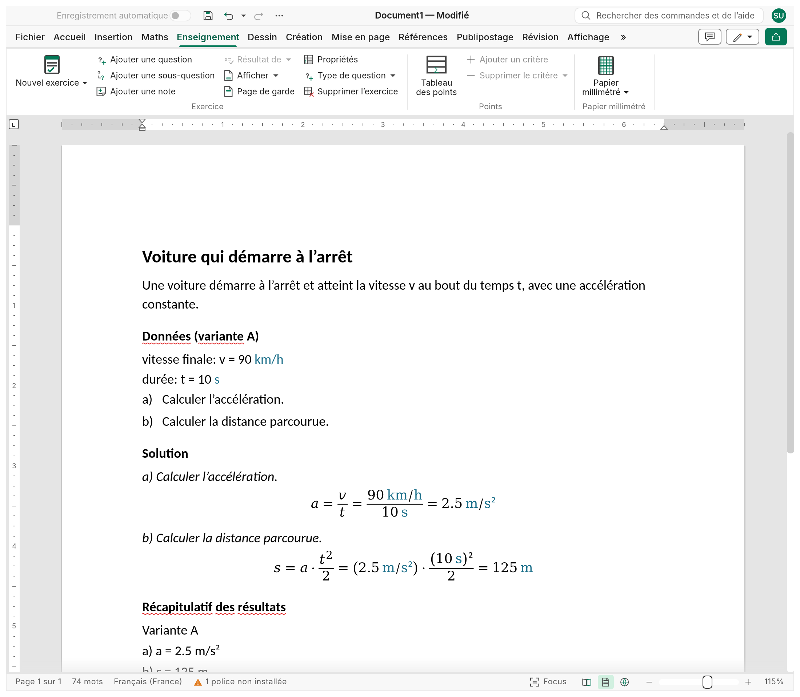
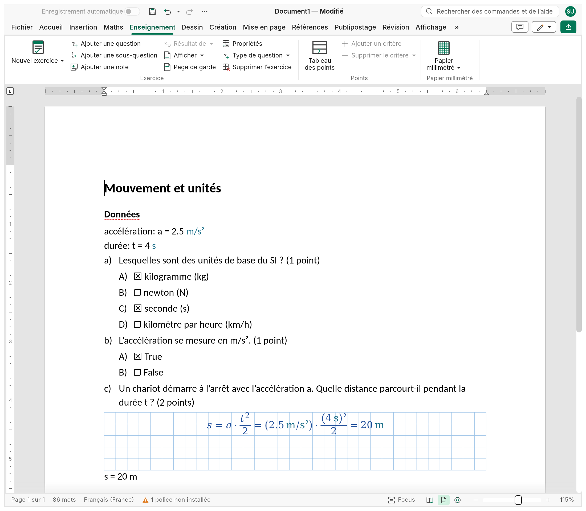
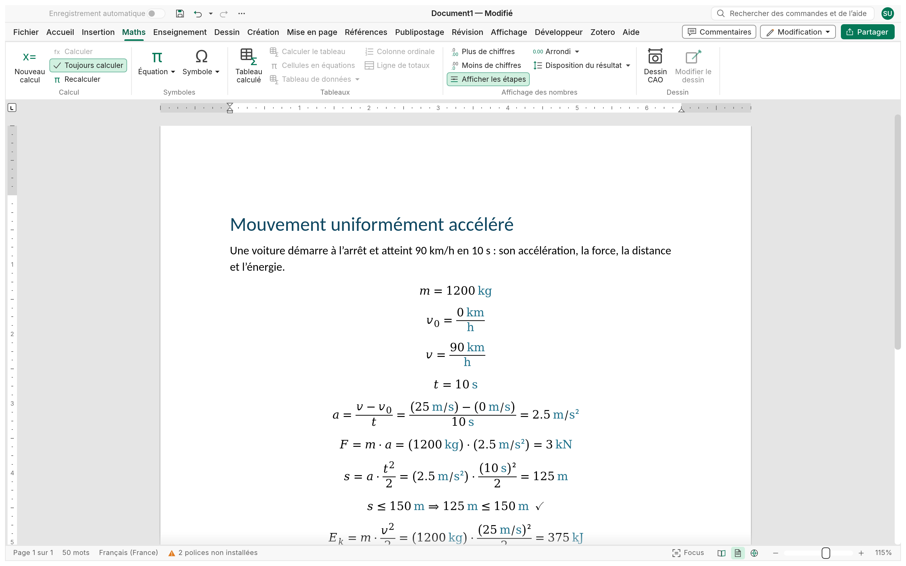

<p align="center">
  
</p>

<h1 align="center">Strix</h1>

<p align="center">
  <b>Évaluations et exercices pour l'enseignant : écrivez l'évaluation, Strix tient le corrigé et les points.</b>
</p>

<p align="center">
  Strix est un éditeur open source, écrit entièrement en Rust, pour préparer les évaluations.
  Les exercices de calcul gardent leurs données, leur corrigé et leurs résultats vivants, avec
  des variantes A, B, C pour chaque rangée ; les questions à choix multiples, vrai/faux et
  ouvertes portent leurs points ; un fichier par exercice forme une banque, et l'évaluation se
  compose à partir d'elle, avec ou sans corrigé. Un tableau des points fait seul les totaux par
  critère ; une grille qui convertit les points en notes est prévue. Dessous, les équations de la
  page calculent, avec leurs unités. Natif sur Windows, macOS, Linux et BSD, et dans le navigateur
  grâce à WebAssembly.
</p>

<p align="center">
  <a href="https://nabre.github.io/strix/fr/"><b>Site</b></a> ·
  <a href="https://github.com/nabre/strix/releases/latest"><b>Télécharger</b></a> ·
  <a href="https://nabre.github.io/strix/app/?sample"><b>Essayer dans le navigateur</b></a> ·
  <a href="https://github.com/nabre/strix/issues"><b>Signaler un problème</b></a>
</p>

<p align="center"><a href="../README.md">English</a> · <a href="README.it.md">Italiano</a> · Français · <a href="README.de.md">Deutsch</a></p>

> **État : alpha.** L'éditeur de documents sur lequel Strix est bâti est mûr ; le moteur de calcul,
> les exercices et la CAO sont récents et évoluent vite. Gardez une copie de vos documents
> importants et [dites-nous ce qui casse](https://github.com/nabre/strix/issues). Le README anglais
> est la référence complète.

## Exercices de calcul

**Enseignement › Exercice › Nouvel exercice** insère un problème corrigé dont la structure résiste
aux modifications : titre, énoncé, **données** (symbole, description, valeur, unité), questions
lettrées imbriquées sur trois niveaux (a), a.1), a.1.1)) ; le **corrigé** reprend chaque question
en lecture seule avec la place pour le développement ; un **récapitulatif des résultats** en fin
de document (`a) a = 2.5 m/s²`).

Le corrigé est un calcul vivant (voir [Les maths WYSIWYG](#les-maths-wysiwyg)) : les données
peuvent avoir des **variantes** A, B, C…, et en choisir une recalcule les données, le corrigé et
le récapitulatif ; chaque rangée a ses propres valeurs et aucun corrigé n'est à refaire à la main.
Chaque exercice est un **bac à sable** (deux exercices peuvent définir `t`) ; du papier quadrillé
peut suivre les questions, et un dessin CAO dans l'énoncé suit les données.

<p align="center">
  <picture>
    <source media="(prefers-color-scheme: dark)" srcset="../site/shots/fr/shot-exercise-dark.png">
    
  </picture>
</p>

## QCM et questions ouvertes

Un exercice peut aussi être un quiz, et chaque question a son propre mode, si bien qu'un quiz les
mélange ([question-modes.md](question-modes.md), en anglais) :

| Mode | Copie de l'élève | Copie corrigée |
|---|---|---|
| **Réponse ouverte** | un espace d'une hauteur donnée en cm, quadrillé ou blanc | la réponse écrite dans l'espace |
| **Choix multiple** | options A), B), C)… avec des cases vides | les bonnes cases cochées (plusieurs possibles) |
| **Vrai/faux** | *Vrai* et *Faux* avec des cases vides | la bonne cochée |
| **Calcul** | un espace quadrillé pour le développement, puis `Réponse : s = ______ m` | le développement en équations vivantes et `Réponse : s = 20 m` |
| **Dessin CAO** | un espace quadrillé pour dessiner | le dessin CAO du corrigé |

Les bonnes réponses **se masquent avec le corrigé** : les cases restent vides et les espaces
gardent leur hauteur, si bien que la copie de l'élève a la même mise en page que celle de
l'enseignant. Chaque question a ses **points**, affichés à côté et additionnés dans le tableau des
points. Le **problème** (énoncé, données, questions, corrigé) reste le type des exercices longs.

<p align="center">
  <picture>
    <source media="(prefers-color-scheme: dark)" srcset="../site/shots/fr/shot-quiz-dark.png">
    
  </picture>
</p>

## De la banque d'exercices à l'évaluation

- **Un fichier par exercice** forme une banque ; chaque fichier porte ses **propriétés
  d'archive** (classe, section, matière, enseignant, durée, points), visibles aussi dans Word
  ([archive.md](archive.md)).
- Un **document maître** compose l'évaluation à partir de ces fichiers, avec sa numérotation, sa
  page de garde, ses sauts de page et les parties affichées (avec ou sans corrigé et résultats) ;
  **les fichiers de la banque ne changent jamais** ([master-documents.md](master-documents.md)).
- La **mise en forme DSA** (troubles de l'apprentissage : lecture, écriture, calcul et mémoire,
  combinables, page toujours blanche) adapte la même évaluation ([dsa.md](dsa.md)).
- Export **PDF** pour l'impression.

## Points et notes

Le **tableau des points** (Enseignement › Points › Tableau des points) a une ligne par exercice et
deux colonnes par critère (les points attribués sur la copie et ceux que vaut l'exercice) ; les
**totaux** par ligne et par colonne suivent pendant la saisie, et le total général est la
propriété **Points** du fichier.

*Prévu :* une **grille de notation** qui convertit les points en notes (seuils, barème,
arrondi). Détails (en anglais) : [exercise.md](exercise.md).

## Les maths WYSIWYG

Pas de feuille séparée, pas de cellules de code, pas de barre de formule. Une équation du document
*est* le calcul : tapée sur place avec l'éditeur d'équations et affichée comme des maths composées.
Strix lit les équations calculées dans l'ordre de lecture et tient les résultats à jour : après
chaque modification (en attendant que le curseur quitte l'équation), sur F9 et à l'ouverture.

```text
m = 1200 kg                        définit m
v_0 = 0 km/h
v = 90 km/h                        les unités se convertissent seules : km/h, s, m/s
t = 10 s
a = (v − v_0)/t =                  →  a = (v − v₀)/t = 2.5 m/s²
F = m·a =                          →  F = m·a = 3 kN
s = a·t²/2 =                       →  s = a·t²/2 = 125 m
s ≤ 150 m                          →  s ≤ 150 m ⇒ 125 m ≤ 150 m ✓
E_k = m·v²/2 = kJ                  →  E_k = m·v²/2 = 375 kJ        (l'unité choisie après =)
v² = 2·a·d                         →  v² = 2·a·d ⇒ d = 125 m         (d est l'unique inconnue : résolue)
```

<p align="center">
  <picture>
    <source media="(prefers-color-scheme: dark)" srcset="../site/shots/fr/shot-calc-dark.png">
    
  </picture>
</p>

- **Un seul `=` pour tout** : définition, résultat à afficher (y compris dans l'unité choisie,
  `E_k = kJ`), formule avec sa valeur, équation à **résoudre** pour son unique inconnue, ou
  **vérification** (`≤ ≥ < > ≠` avec ✓/✗).
- **Résolution** : l'inconnue est isolée symboliquement quand elle apparaît une fois, sinon
  trouvée numériquement.
- **Des unités partout** : SI avec préfixes, unités techniques (`mm`, `kN`, `MPa`, `bar`, `kWh`…),
  unités sans dimension conservées (`%`, `‰`, `°`, `rad`). Les erreurs de dimension (`2 m + 3 s`)
  sont signalées, jamais calculées en silence. L'unité de travail suit ce que vous écrivez ; une
  unité mal capitalisée reçoit un indice (« vouliez-vous dire kN ? »).
- **Étapes de la solution**, **tableaux calculés** (colonnes avec unités et formules, comme
  `ρ [g/cm³] = m/V` pour les mesures de laboratoire, et `Σ =`, `mean =`, `min =`, `max =`), **sommes, plages et vecteurs**, **format numérique**.
- **Les erreurs n'arrêtent pas la feuille** : une instruction en échec affiche `⚠` et son message.

Le calcul est dans l’onglet **Math** ; exercices, points et papier quadrillé dans l’onglet **Enseignement**. Détails (en anglais) : [calc.md](calc.md).

## Des dessins CAO pilotés par les calculs

**Insertion › CAD Drawing** place un dessin technique dans le texte. Coordonnées, rayons et angles
peuvent être des **expressions des paramètres** (`["b", 0]`, `b/2`) : changez `b = 6 cm` et le
triangle se redessine, chaque variante a donc sa figure ; les cotes rappellent les paramètres
(`{{b}}` affiche `6 cm`). L'éditeur
sur la feuille du dessin offre une ligne de commande pour les coordonnées, des **accrochages
exacts** sur les vraies courbes, des poignées qui gardent les expressions, un volet Propriétés et
des calques. Le dessin est enregistré en JSON dans le fichier `.xmath` avec une image SVG.
Détails : [cad.md](cad.md).

## Papier quadrillé

**Insertion › Graph Paper** quadrille la page ou un bloc du texte, comme un cahier, avec un
trait plus fort tous les N carreaux, net à tout zoom et en PDF. Détails : [graph-paper.md](graph-paper.md).

## Un vrai éditeur de documents

Dessous, un vrai traitement de texte (Strix est un fork de WordCraft) : ruban, styles, listes,
tableaux, images et formes, en-têtes et pieds de page, sections et colonnes, notes, citations et
tables des matières, commentaires et suivi des modifications, orthographe et césure, publipostage
et impression. L'interface suit la langue du système (français, anglais, italien ou allemand).

## Fichiers

| | Formats |
|---|---|
| **Enregistre** | `.xmath` (document) et `.xmathm` (modèle) : un paquet OOXML qui garde vivants calculs, exercices et dessins |
| **Réenregistre** (documents sans objets Strix) | `.docx`, `.docm`, `.dotx`, `.dotm`, `.odt`, `.rtf`, `.txt`, Word XML |
| **Exporte** (copies statiques) | PDF, PNG, LaTeX, HTML, Markdown |
| **Ouvre** | `.docx`, `.docm`, `.dotx`, `.dotm`, `.doc`, `.odt`, `.rtf`, `.md`, `.html`, `.tex`, `.txt` |

Strix ouvre un `.docx` (ou `.odt`, `.rtf`…) et le réenregistre dans le même format tant que le
document ne contient pas d'**objets Strix** : calculs, tableaux calculés, exercices, dessins CAO ou
papier quadrillé. Ces formats en perdraient les calculs vivants et la source des dessins ; un
document qui en contient s'enregistre donc seulement en `.xmath` : Enregistrer propose un `.xmath`
du même nom et dit ce qui serait perdu (« 3 calculs, 1 dessin CAO »), Enregistrer sous écarte les
formats qui les perdraient, et `file.save`, `strix-cli convert` et MCP `save_document` refusent avec
la même explication. Les exports (PDF, PNG, LaTeX, HTML, Markdown) sont des copies et fonctionnent
toujours. Un fichier `.xmath` reste un paquet standard : d'autres logiciels affichent les dernières
valeurs calculées.

## Pour les agents : commandes, CLI, MCP

Tout ce que fait Strix est une **commande** d'un registre unique. Le ruban, les raccourcis, la
recherche de commandes, la ligne de commande, le canal de contrôle et le serveur MCP exécutent les
mêmes commandes, et les appels programmatiques n'ouvrent jamais de boîte de dialogue.

```sh
claude mcp add strix -- strix-cli mcp                      # documents sans interface
strix --control 7981 &                                     # ou piloter l'application ouverte
claude mcp add strix-app -- strix-cli mcp --connect 127.0.0.1:7981
```

Voir [mcp.md](mcp.md) et le [protocole de contrôle](control-protocol.md).

## Télécharger

Installateurs et versions portables sont sur la [page des versions](https://github.com/nabre/strix/releases)
et sur le [site](https://nabre.github.io/strix/fr/#download) : Windows (MSI, ZIP portable et exe portable, qui garde ses réglages dans un dossier
`StrixData` à côté de lui ; x64,
x86, ARM64), macOS (DMG universel), Linux (AppImage, deb, rpm, Flatpak, Arch ; x86_64 et aarch64,
plus riscv64), FreeBSD et la version web. La signature des versions Windows (SignPath
Foundation) est en cours de mise en place. Confidentialité : Strix vérifie s'il existe une
nouvelle version au démarrage et une fois par jour (Fichier › Informations), et rien d'autre : ni
télémétrie, ni compte ; détails dans [code-signing.md](code-signing.md) et [updates.md](updates.md).

## Compiler et lancer

Il faut une chaîne d'outils Rust (1.95 ou plus récente) ; pour la version web, aussi
[Trunk](https://trunkrs.dev/) et la cible `wasm32-unknown-unknown`.

```sh
git clone https://github.com/nabre/strix
cd strix
cargo run --release -p strix -- --sample          # l’application avec l’évaluation d’exemple
cargo xtask dev                                   # build de débogage, recompilée et relancée à chaque modification (watchexec)
                                                  # sans écran (sandbox, SSH) ou --web : build web sur http://127.0.0.1:8771/?sample
cargo run --release -p strix -- probleme.xmath    # ouvrir un document Strix
strix-cli convert probleme.xmath probleme.pdf     # export statique : pdf, png, tex, html, md
```

Web : `cd apps/strix-web && trunk serve`, puis ouvrir <http://127.0.0.1:8771/?sample>.

## État et feuille de route

Fait : calculs avec un seul `=` et des unités, tableaux calculés, exercices avec données et
variantes, quiz avec les cinq modes de question, évaluations composées depuis la banque
d'exercices par les documents maîtres, mise en forme DSA, tableau des points, papier quadrillé,
dessins CAO paramétriques. Les prochaines fonctionnalités sont en cours de définition :
[ROADMAP.md](../ROADMAP.md) (avec le journal des progrès). L'éditeur de documents suit la
[feuille de route de WordCraft](https://github.com/storytold/wordcraft/blob/main/ROADMAP.md).

## Licence et crédits

Strix est distribué sous double licence [MIT](../LICENSE-MIT) ou [Apache-2.0](../LICENSE-APACHE),
au choix. Copyright (c) 2026 nabre et les contributeurs de Strix. Strix est un fork de
[WordCraft](https://github.com/storytold/wordcraft) ; il n'est ni affilié à ses auteurs ni approuvé
par eux, et les mentions requises sont dans [NOTICE](../NOTICE). Polices, icônes, dictionnaires et
traductions inclus gardent leurs licences ouvertes, listées dans [ATTRIBUTION.md](../ATTRIBUTION.md).
Microsoft et Word sont des marques de Microsoft Corporation ; Strix est un projet indépendant, ni
affilié à Microsoft, ni approuvé ou parrainé par Microsoft, et lit et écrit les fichiers Word à
partir des spécifications publiées (ECMA-376, ISO/IEC 29500).
