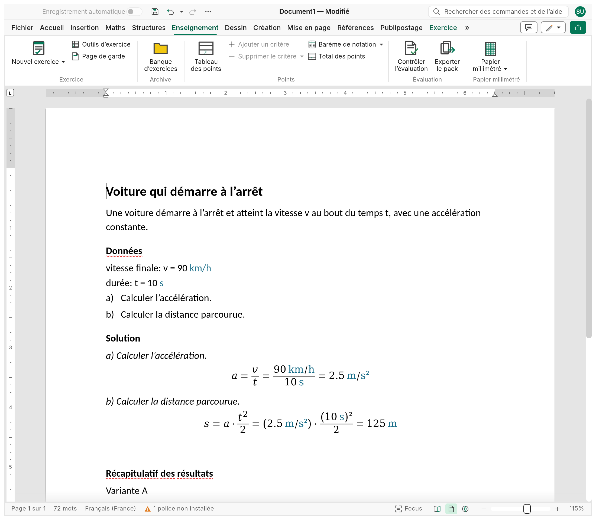
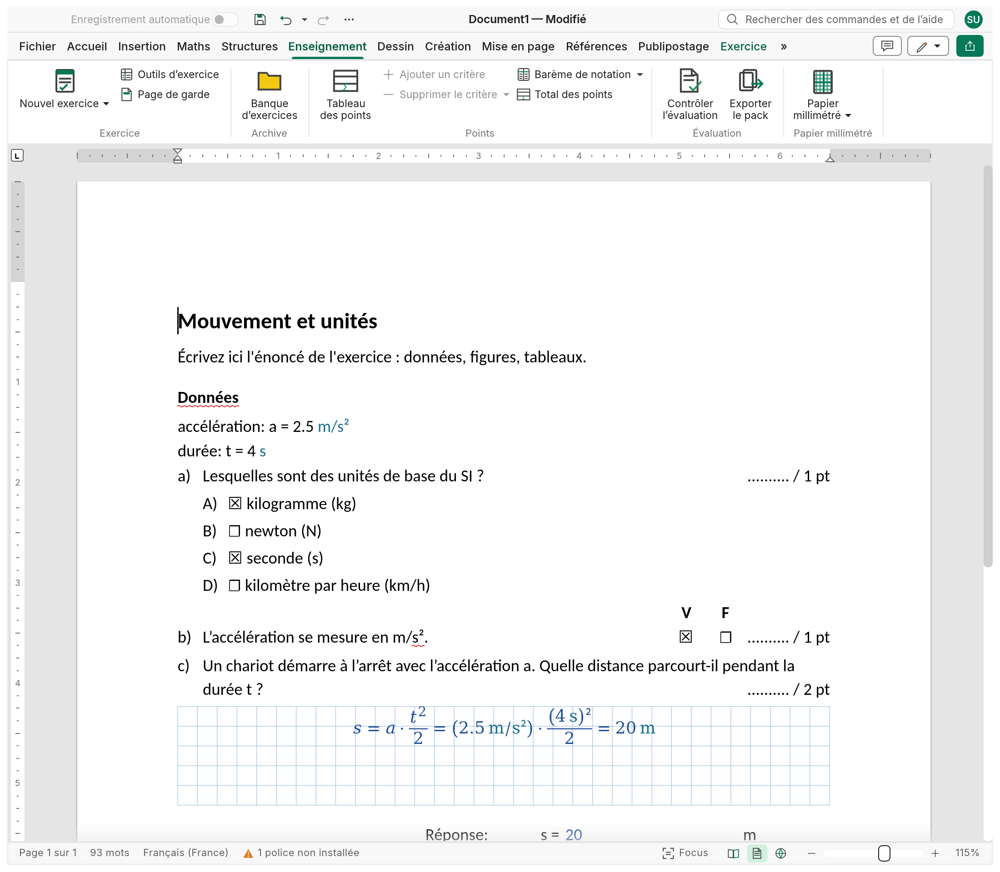
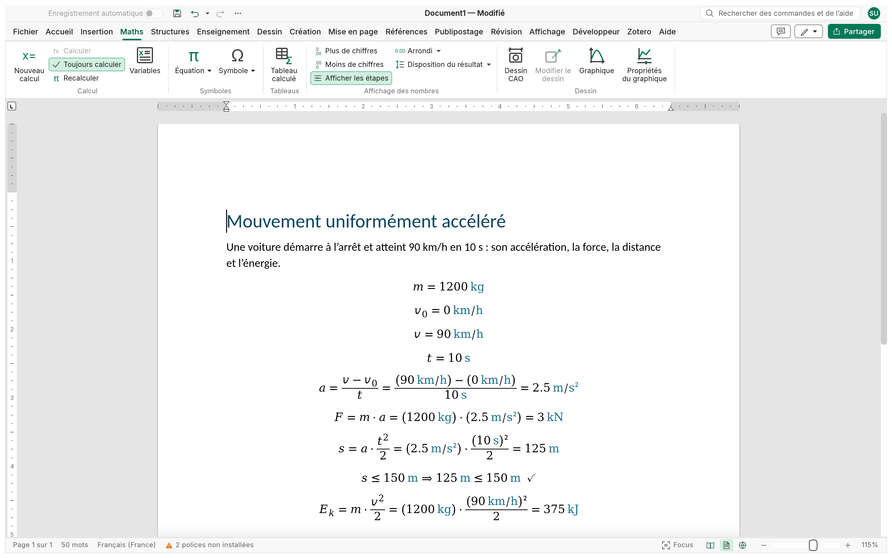
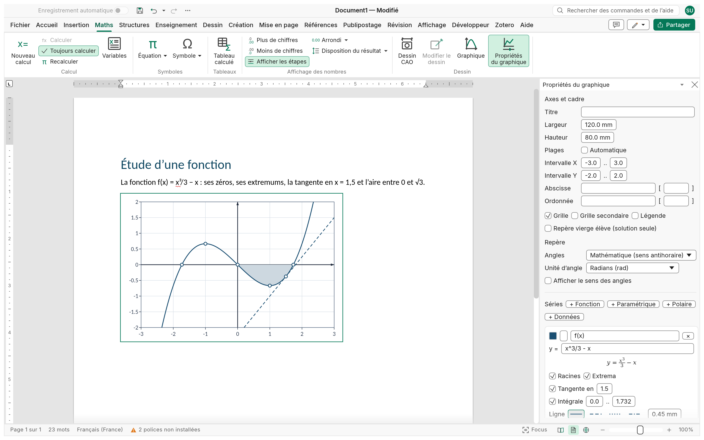
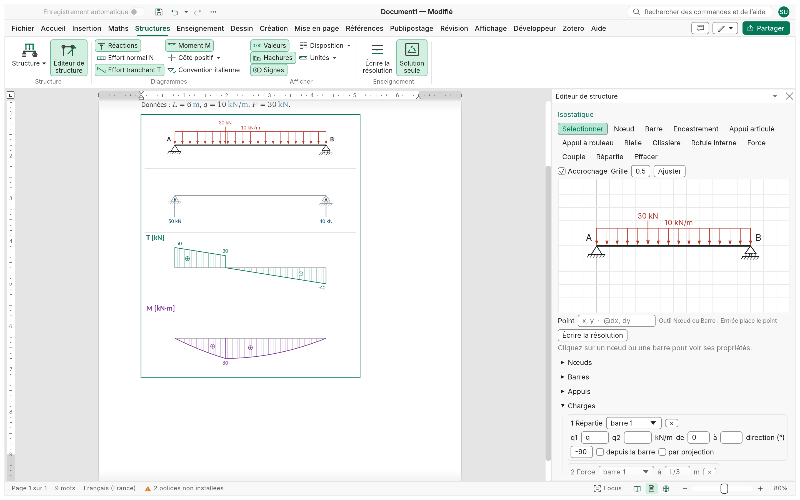

<p align="center">
  
</p>

<h1 align="center">Strix</h1>

<p align="center">
  <b>Évaluations et exercices pour l'enseignant : écrivez l'évaluation, Strix tient le corrigé et les points.</b>
</p>

<p align="center">
  Strix est un éditeur open source, écrit entièrement en Rust, pour préparer les évaluations.
  Les exercices de calcul gardent leurs données, leur corrigé et leurs résultats vivants, avec
  des variantes A, B, C pour chaque rangée ; les questions à choix multiples, vrai/faux et
  ouvertes portent leurs points ; un fichier par exercice forme une banque, et l'évaluation se
  compose à partir d'elle, avec ou sans corrigé. Un tableau des points fait seul les totaux par
  critère, et un barème les convertit en notes. Dessous, les équations de la page calculent, avec
  leurs unités, et graphiques, dessins CAO et structures planes les suivent. Natif sur Windows,
  macOS, Linux et BSD, et dans le navigateur grâce à WebAssembly.
</p>

<p align="center">
  <a href="https://nabre.github.io/strix/fr/"><b>Site</b></a> ·
  <a href="https://github.com/nabre/strix/releases/latest"><b>Télécharger</b></a> ·
  <a href="https://nabre.github.io/strix/app/?sample"><b>Essayer dans le navigateur</b></a> ·
  <a href="https://github.com/nabre/strix/issues"><b>Signaler un problème</b></a>
</p>

<p align="center"><a href="../README.md">English</a> · <a href="README.it.md">Italiano</a> · Français · <a href="README.de.md">Deutsch</a></p>

> **État : alpha.** L'éditeur de documents sur lequel Strix est bâti est mûr ; le moteur de calcul,
> les exercices, la CAO, les graphiques et les structures sont récents et évoluent vite. Gardez une copie de vos documents
> importants et [dites-nous ce qui casse](https://github.com/nabre/strix/issues). Le README anglais
> est la référence complète.

## Exercices de calcul

**Enseignement › Exercice › Nouvel exercice** insère un problème corrigé dont la structure résiste
aux modifications : titre, énoncé, **données** (symbole, description, valeur, unité), questions
lettrées imbriquées sur trois niveaux (a), a.1), a.1.1)) ; le **corrigé** reprend chaque question
en lecture seule avec la place pour le développement ; un **récapitulatif des résultats** en fin
de document (`a) a = 2.5 m/s²`).

Le corrigé est un calcul vivant (voir [Les maths WYSIWYG](#les-maths-wysiwyg)) : les données
peuvent avoir des **variantes** A, B, C…, et en choisir une recalcule les données, le corrigé et
le récapitulatif ; chaque rangée a ses propres valeurs et aucun corrigé n'est à refaire à la main.
Chaque exercice est un **bac à sable** (deux exercices peuvent définir `t`) ; du papier quadrillé
peut suivre les questions, et un dessin CAO, un [graphique](#graphiques) ou une
[structure](#structures-planes) dans l'énoncé suit les données.

Avec le curseur dans un exercice, l'onglet **Exercice** apparaît à côté des autres, avec ses
questions, ses variantes et sa mise en page ; **Paramètres de la question** (type et points de
chaque question) et **Données** (une équation par donnée, `L = 4.5 m`, avec les variantes en
boutons) s'ouvrent en volets à côté du document. **Générer des variantes** crée de nouvelles
variantes à partir de listes ou de plages de valeurs, en ne gardant que celles dont les résultats
sont propres (peu de décimales, positifs, tous différents), et chaque variante est vérifiée pendant
la saisie : une variante dont le calcul échoue (unités qui ne concordent pas, racine d'un nombre
négatif) est signalée aussitôt.

<p align="center">
  <picture>
    <source media="(prefers-color-scheme: dark)" srcset="../site/shots/fr/shot-exercise-dark.png">
    
  </picture>
</p>

## QCM et questions ouvertes

Un exercice peut aussi être un quiz, et chaque question a son propre mode, si bien qu'un quiz les
mélange ([question-modes.md](question-modes.md), en anglais) :

| Mode | Copie de l'élève | Copie corrigée |
|---|---|---|
| **Réponse ouverte** | un espace d'une hauteur donnée en cm, quadrillé ou blanc | la réponse écrite dans l'espace |
| **Choix multiple** | options A), B), C)… avec des cases vides | les bonnes cases cochées (plusieurs possibles) |
| **Vrai/faux** | *Vrai* et *Faux* avec des cases vides | la bonne cochée |
| **Calcul** | un espace quadrillé pour le développement, puis `Réponse : s = ______ m` | le développement en équations vivantes et `Réponse : s = 20 m` |
| **Dessin CAO** | un espace quadrillé pour dessiner, ou une figure à compléter | le dessin CAO du corrigé, ou la figure complétée |
| **Texte à trous** | un texte avec une ligne où écrire chaque mot masqué (ou valeur calculée) | les mots masqués, dans le style *Mot masqué* |
| **Appariement** | deux colonnes, celle de droite mélangée, avec des cases pour les lettres | les lettres des bonnes paires |
| **Exemple résolu** | l'exemple avec sa solution, toujours affiché, sans points | la même chose |

Les bonnes réponses **se masquent avec le corrigé** : les cases restent vides et les espaces
gardent leur hauteur, si bien que la copie de l'élève a la même mise en page que celle de
l'enseignant. Chaque question a ses **points**, affichés à côté et additionnés dans le tableau des
points. Le **problème** (énoncé, données, questions, corrigé) reste le type des exercices longs.

<p align="center">
  <picture>
    <source media="(prefers-color-scheme: dark)" srcset="../site/shots/fr/shot-quiz-dark.png">
    
  </picture>
</p>

## De la banque d'exercices à l'évaluation

- **Un fichier par exercice** forme une banque ; chaque fichier porte ses **propriétés
  d'archive** (classe, section, matière, enseignant, durée, thèmes, points), visibles aussi dans
  Word. Le volet **Banque d’exercices** (Enseignement › Archive) cherche dans un dossier
  d'exercices par propriétés et par texte, et en insère un en copie ou en sous-document lié
  ([archive.md](archive.md)).
- Un **document maître** compose l'évaluation à partir de ces fichiers, avec sa numérotation, sa
  page de garde, ses sauts de page et les parties affichées (avec ou sans corrigé et résultats) ;
  **les fichiers de la banque ne changent jamais** ([master-documents.md](master-documents.md)).
- La **mise en forme DSA** (le groupe **TSA** de l'onglet Création ; troubles de l'apprentissage :
  lecture, écriture, calcul et mémoire, combinables, page toujours blanche) adapte la même
  évaluation ([dsa.md](dsa.md)).
- **Contrôler l’évaluation** (Enseignement › Évaluation) relit l'évaluation avant l'impression :
  toutes les variantes, les bonnes réponses, les corrigés manquants, les points et leurs totaux,
  les espaces de réponse, la durée et le nombre de pages de chaque variante, chaque problème à un
  clic.
- **Exporter le pack d’évaluation** (Enseignement › Évaluation) écrit en une fois le PDF des élèves
  pour chaque variante, leur version DSA et le corrigé de l'enseignant avec les solutions
  développées, le barème et un tableau des résultats de toutes les variantes.
- Export **PDF** pour l'impression.

## Points et notes

Le **tableau des points** (Enseignement › Points › Tableau des points) a une ligne par exercice et
deux colonnes par critère (les points attribués sur la copie et ceux que vaut l'exercice) ; les
**totaux** par ligne et par colonne suivent pendant la saisie, et le total général est la
propriété **Points** du fichier.

Le **barème** (Enseignement › Points › Barème de notation) convertit les points en notes : un
tableau avec une ligne par note, de la plus basse à la plus haute selon le pas choisi (de 1 à 10
par demi-point, par exemple), et les points qui la donnent sous forme d'intervalle `[12; 14[`. Il
part d'un préréglage scolaire (Italie 1–10, Suisse 1–6, Allemagne 6–1, France 0–20,
pourcentages) ou du vôtre : le seuil de réussite et sa note, une droite ou deux, les points
arrondis à un multiple (0,25, 0,5), le maximum pris dans le tableau des points ou fixé, et si les
élèves le voient. **Propriétés du barème** s'ouvre à côté du document avec un aperçu, les notes
suffisantes en vert. Détails (en anglais) : [exercise.md](exercise.md).

## Les maths WYSIWYG

Pas de feuille séparée, pas de cellules de code, pas de barre de formule. Une équation du document
*est* le calcul : tapée sur place avec l'éditeur d'équations et affichée comme des maths composées.
Strix lit les équations calculées dans l'ordre de lecture et tient les résultats à jour : après
chaque modification (en attendant que le curseur quitte l'équation), sur F9 et à l'ouverture.

```text
m = 1200 kg                        définit m
v_0 = 0 km/h
v = 90 km/h                        les unités se convertissent seules : km/h, s, m/s
t = 10 s
a = (v − v_0)/t =                  →  a = (v − v₀)/t = 2.5 m/s²
F = m·a =                          →  F = m·a = 3 kN
s = a·t²/2 =                       →  s = a·t²/2 = 125 m
s ≤ 150 m                          →  s ≤ 150 m ⇒ 125 m ≤ 150 m ✓
E_k = m·v²/2 = kJ                  →  E_k = m·v²/2 = 375 kJ        (l'unité choisie après =)
v² = 2·a·d                         →  v² = 2·a·d ⇒ d = 125 m         (d est l'unique inconnue : résolue)
```

<p align="center">
  <picture>
    <source media="(prefers-color-scheme: dark)" srcset="../site/shots/fr/shot-calc-dark.png">
    
  </picture>
</p>

- **Un seul `=` pour tout** : définition, résultat à afficher (y compris dans l'unité choisie,
  `E_k = kJ`), formule avec sa valeur, équation à **résoudre** pour son unique inconnue, ou
  **vérification** (`≤ ≥ < > ≠` avec ✓/✗).
- **Résolution** : l'inconnue est isolée symboliquement quand elle apparaît une fois, sinon
  trouvée numériquement.
- **Des unités partout** : SI avec préfixes, unités techniques (`mm`, `kN`, `MPa`, `bar`, `kWh`…),
  unités sans dimension conservées (`%`, `‰`, `°`, `rad`). Les erreurs de dimension (`2 m + 3 s`)
  sont signalées, jamais calculées en silence. L'unité de travail suit ce que vous écrivez ; une
  unité mal capitalisée reçoit un indice (« vouliez-vous dire kN ? »).
- **Étapes de la solution**, **tableaux calculés** (colonnes avec unités et formules, comme
  `ρ [g/cm³] = m/V` pour les mesures de laboratoire, et `Σ =`, `mean =`, `min =`, `max =`), **sommes, plages et vecteurs**, **format numérique**.
- **Dérivées, intégrales et limites** : `f′(a)` et `f″(a)` d'une fonction que vous définissez
  (`f(x) = …`), intégrales définies `∫_a^b f(x) dx` avec unités, limites à droite et à gauche,
  sommes binomiales ; les structures de l'éditeur d'équations (valeur absolue, racines d'indice
  quelconque, logarithmes en base, accolades de cas, déterminants) se lisent comme des calculs.
  `°C` et `°F` se convertissent comme températures et comme écarts.
- **Le volet Variables** (Maths › Calcul › Variables) liste chaque nom défini jusque-là avec sa
  valeur, et convertit les unités.
- **Les erreurs n'arrêtent pas la feuille** : une instruction en échec affiche `⚠` et son message.

Le calcul est dans l’onglet **Maths** (avec Tableau calculé, qui a son propre onglet tant que le
curseur est dans un tableau, le format numérique, Dessin CAO et Graphique) ; les structures ont
l'onglet **Structures** ; exercices, points, barème et papier quadrillé sont dans l’onglet
**Enseignement**. Détails (en anglais) : [calc.md](calc.md).

## Des dessins CAO pilotés par les calculs

**Insertion › Dessin CAO** place un dessin technique dans le texte. Coordonnées, rayons et angles
peuvent être des **expressions des paramètres** (`["b", 0]`, `b/2`) : changez `b = 6 cm` et le
triangle se redessine, chaque variante a donc sa figure ; les cotes rappellent les paramètres
(`{{b}}` affiche `6 cm`). L'éditeur sur la feuille du dessin, avec ses onglets (**Dessin CAO**,
**Annotation CAO**, **Sortie CAO**), offre une ligne de commande pour les coordonnées, des
**accrochages exacts** sur les vraies courbes, des poignées qui gardent les expressions, des cotes
alignées, horizontales, verticales et angulaires, des hachures et les outils de modification
(déplacer, copier, faire pivoter, mettre à l'échelle, symétrie, décaler, ajuster, prolonger,
raccorder, chanfreiner, réseaux), chacun avec un aperçu avant le clic ; un volet Propriétés et des
calques. Le dessin est enregistré en JSON dans le fichier avec une image SVG. *Prévu :* des cotes
qui pilotent le dessin, avec des contraintes géométriques. Détails : [cad.md](cad.md).

## Graphiques

**Maths › Dessin › Graphique** trace dans le texte un graphique cartésien vivant, à partir des
calculs qui le précèdent ([plot.md](plot.md), en anglais) : fonctions `y = f(x)` (pôles et
asymptotes jamais reliés), courbes paramétriques et polaires, données expérimentales d'un tableau
calculé avec leurs barres d'erreur et une régression linéaire ou quadratique avec R². Une fonction
peut montrer ses **zéros**, ses **extremums**, une **tangente** et une **intégrale** à l'aire
hachurée ; **Insérer l’analyse dans le document** les écrit après le graphique en calculs vivants.
Les axes sont nommés au bout de leurs flèches, et ces noms sont les variables des formules ; les
plages s'adaptent à ce qu'il y a à montrer ; les angles vont dans le sens mathématique ou
topographique, en rad, ° ou gon. Changez un paramètre et le graphique se redessine ; dans la copie
de l'élève, un graphique (ou une seule courbe) marqué comme solution laisse une grille vide et
graduée de la même taille. Le volet **Propriétés du graphique** modifie chaque série.

<p align="center">
  <picture>
    <source media="(prefers-color-scheme: dark)" srcset="../site/shots/fr/shot-plot-dark.png">
    
  </picture>
</p>

## Structures planes

L'onglet **Structures** (entre Maths et Enseignement) insère une **poutre, un portique ou un
treillis**, résolu là où il se trouve et dessiné comme dans un manuel
([structures.md](structures.md), en anglais) : la structure avec ses appuis et ses charges, les
**réactions d'appui** et les diagrammes de l'**effort normal N**, de l'**effort tranchant T** et du
**moment fléchissant M** l'un sous l'autre à la même échelle, hachurés, avec ⊕/⊖ et les valeurs
remarquables ; un treillis montre l'effort normal de chaque barre, traction et compression en deux
couleurs. Chaque charge a son nom (`F_1`, `q_2`, `C_3`), le dessin porte les **cotes** de la
structure, les pentes et les angles des forces, et les diagrammes marquent leurs **abscisses** (où
tombe une valeur remarquable, mesurée depuis le début de la barre).

- **N'importe quelle structure plane** : encastrements, appuis articulés, appuis à rouleau,
  bielles et glissières sous n'importe quel angle, rotules internes ; forces, couples et charges
  réparties uniformes, triangulaires ou trapézoïdales, en axes globaux ou locaux, par unité de
  longueur ou de projection. Elle est classée isostatique, hyperstatique de degré *h* ou
  hypostatique, et résolue par la méthode des déplacements.
- **Pilotée par les calculs** : chaque longueur et chaque charge peut être un paramètre (`L`,
  `q`), si bien que chaque variante d'un exercice a sa structure et ses diagrammes ; la convention
  italienne (moment du côté des fibres tendues) est celle par défaut, et le côté positif de chaque
  diagramme se choisit.
- **L'Éditeur de structure** : un double-clic sur une structure l'ouvre à la place de la page,
  avec son propre onglet du ruban : une feuille avec grille et accrochages, des outils pour les
  nœuds, les barres, les appuis, les rotules et les charges, la sélection par clic et par fenêtre,
  des poignées pour déplacer les nœuds, porter et tourner les charges et étirer les charges
  réparties, un menu contextuel (diviser ou joindre des barres, appuis, rotules, charges), des
  coordonnées saisies au clavier, les propriétés de la sélection et les tableaux des nœuds, des
  barres, des appuis et des charges.
- **La résolution écrite** : **Écrire la résolution** place la solution après la structure en
  calculs vivants : d'abord les charges, leurs résultantes et composantes et le bras de levier de
  chaque force, puis les équations d'équilibre écrites sous forme littérale
  (`0 kN·m = V_B·6 m − F_1·d_(1,A)`), chacune résolue pour sa réaction avec ses étapes, puis les
  lois de chaque barre (`T_1(x) = V_A − q_1·x`) tronçon par tronçon, avec leurs valeurs aux
  extrémités et les extremums du moment. La résolution suit la structure : chaque modification de
  celle-ci, ou d'un paramètre qu'elle lit, la réécrit.
- **Un exercice sur la structure** : **Exercice sur une structure** écrit un problème entier (la
  structure dans l'énoncé ; réactions, N, T, où T s'annule, le moment maximal à cet endroit, M),
  chaque réponse avec sa résolution et son propre dessin ; **Vers l'exercice** et **Vers la
  structure** font passer une structure, là où elle se trouve, du rapport technique à l'exercice et
  inversement.
- Dans la copie de l'élève, **Solution seule** laisse de côté les réactions et les diagrammes et
  garde les cadres vides, si bien que les deux copies ont la même mise en page.

<p align="center">
  <picture>
    <source media="(prefers-color-scheme: dark)" srcset="../site/shots/fr/shot-structure-dark.png">
    
  </picture>
</p>

## Papier quadrillé

**Insertion › Papier millimétré** quadrille la page ou un bloc du texte, comme un cahier, avec un
trait plus fort tous les N carreaux, net à tout zoom et en PDF. Détails : [graph-paper.md](graph-paper.md).

## Un vrai éditeur de documents

Dessous, un vrai traitement de texte (Strix est un fork de WordCraft) : ruban, styles, listes,
tableaux, images et formes, en-têtes et pieds de page, sections et colonnes, notes, citations et
tables des matières, commentaires et suivi des modifications, orthographe et césure, publipostage
et impression. L'interface suit la langue du système (français, anglais, italien ou allemand).

## Fichiers

| | Formats |
|---|---|
| **Enregistre** | `.xmath` (document) et `.xmathm` (modèle), et les fichiers Word `.docx`, `.docm`, `.dotx`, `.dotm` : tous gardent vivants calculs, exercices, dessins, graphiques et structures |
| **Réenregistre** (documents sans objets Strix) | `.odt`, `.rtf`, `.txt`, Word XML |
| **Exporte** (copies statiques) | PDF, PNG, LaTeX, HTML, Markdown |
| **Ouvre** | `.xmath`, `.xmathm`, `.docx`, `.docm`, `.dotx`, `.dotm`, `.doc`, `.odt`, `.rtf`, `.md`, `.html`, `.tex`, `.txt`, Word XML |

Un nouveau document est un `.xmath`, et comme Word, Strix réenregistre un fichier dans le format
d'où il vient. **Les fichiers Word gardent les objets Strix en passant par Word** : un `.docx`
écrit par Strix porte une seconde fois chaque calcul, tableau calculé, exercice, dessin CAO,
graphique, structure et papier quadrillé, dans des contrôles de contenu et une partie XML
personnalisée que Word conserve quand il enregistre. Ouvrez le fichier dans Word, modifiez le texte
autour, enregistrez, et dans Strix les objets redeviennent vivants ; un objet modifié dans Word
reste tel que Word l'a laissé et attend votre décision ([word-round-trip.md](word-round-trip.md),
en anglais). Les autres formats modifiables (ODT, RTF, texte brut, Word XML) n'en garderaient que
le dernier aspect ; un document qui en contient ne s'enregistre donc pas dans ces formats :
Enregistrer propose un `.xmath` et dit ce qui serait perdu (« 3 calculs, 1 dessin CAO »),
Enregistrer sous les écarte, et `file.save`, `strix-cli convert` et MCP `save_document` refusent
avec la même explication. Les exports (PDF, PNG, LaTeX, HTML, Markdown) sont des copies et
fonctionnent toujours. Un fichier `.xmath` reste un paquet standard : d'autres logiciels affichent
les dernières valeurs calculées.

## Pour les agents : commandes, CLI, MCP

Tout ce que fait Strix est une **commande** d'un registre unique. Le ruban, les raccourcis, la
recherche de commandes, la ligne de commande, le canal de contrôle et le serveur MCP exécutent les
mêmes commandes, et les appels programmatiques n'ouvrent jamais de boîte de dialogue. Parmi les
commandes d'enseignement, de calcul et de dessin figurent `exercise.insert`, `exercise.setData`,
`exercise.variant`, `exercise.generateVariants`, `exercise.scores`, `exercise.grading`,
`exercise.check`, `file.exportPack`, `design.dsa`, `calc.insert`, `table.calc`, `insert.cad`,
`plot.insert`, `plot.analysis`, `structure.insert`, `structure.working`, `structure.exercise` et
`structure.mode` : un agent peut préparer
une évaluation entière, avec ses variantes, son barème et ses copies à imprimer.

```sh
claude mcp add strix -- strix-cli mcp                      # documents sans interface
strix --control 7981 &                                     # ou piloter l'application ouverte
claude mcp add strix-app -- strix-cli mcp --connect 127.0.0.1:7981
```

Voir [mcp.md](mcp.md) et le [protocole de contrôle](control-protocol.md).

## Télécharger

Installateurs et versions portables sont sur la [page des versions](https://github.com/nabre/strix/releases)
et sur le [site](https://nabre.github.io/strix/fr/#download) : Windows (MSI, ZIP portable et exe portable, qui garde ses réglages dans un dossier
`StrixData` à côté de lui ; x64,
x86, ARM64), macOS (DMG universel), Linux (AppImage, deb, rpm, Flatpak, Arch ; x86_64 et aarch64,
plus riscv64), FreeBSD et la version web. La signature des versions Windows (SignPath
Foundation) est en cours de mise en place. Confidentialité : Strix vérifie s'il existe une
nouvelle version au démarrage et une fois par jour (Fichier › Informations), et rien d'autre : ni
télémétrie, ni compte ; détails dans [code-signing.md](code-signing.md) et [updates.md](updates.md).

## Compiler et lancer

Il faut une chaîne d'outils Rust (1.95 ou plus récente) ; pour la version web, aussi
[Trunk](https://trunkrs.dev/) et la cible `wasm32-unknown-unknown`.

```sh
git clone https://github.com/nabre/strix
cd strix
cargo run --release -p strix -- --sample          # l’application avec l’évaluation d’exemple
cargo xtask dev                                   # build de débogage, recompilée et relancée à chaque modification (watchexec)
                                                  # sans écran (sandbox, SSH) ou --web : build web sur http://127.0.0.1:8771/?sample
cargo run --release -p strix -- probleme.xmath    # ouvrir un document Strix
strix-cli convert probleme.xmath probleme.pdf     # export statique : pdf, png, tex, html, md
```

Web : `cd apps/strix-web && trunk serve`, puis ouvrir <http://127.0.0.1:8771/?sample>.

## État et feuille de route

Fait : calculs avec un seul `=` et des unités, dérivées, intégrales et limites, tableaux
calculés, exercices avec données et variantes (générées et vérifiées), quiz avec tous les modes de
question, évaluations composées depuis la banque d'exercices par les documents maîtres, mise en
forme DSA, contrôle avant l'impression et export du pack, tableau des points et barème, papier
quadrillé, dessins CAO paramétriques avec les outils de modification, graphiques avec leur
analyse, structures planes avec leur résolution et leurs exercices, fichiers Word qui gardent les objets Strix.
Prochaines étapes notées : systèmes d'équations et matrices, un tableau des résultats par
exercice et un récapitulatif par variante, questions à remettre en ordre, cotes CAO qui pilotent
le dessin. Les détails sont dans [ROADMAP.md](../ROADMAP.md) (avec le journal des progrès).
L'éditeur de documents suit la [feuille de route de WordCraft](https://github.com/storytold/wordcraft/blob/main/ROADMAP.md).

## Licence et crédits

Strix est distribué sous double licence [MIT](../LICENSE-MIT) ou [Apache-2.0](../LICENSE-APACHE),
au choix. Copyright (c) 2026 nabre et les contributeurs de Strix. Strix est un fork de
[WordCraft](https://github.com/storytold/wordcraft) ; il n'est ni affilié à ses auteurs ni approuvé
par eux, et les mentions requises sont dans [NOTICE](../NOTICE). Polices, icônes, dictionnaires et
traductions inclus gardent leurs licences ouvertes, listées dans [ATTRIBUTION.md](../ATTRIBUTION.md).
Microsoft et Word sont des marques de Microsoft Corporation ; Strix est un projet indépendant, ni
affilié à Microsoft, ni approuvé ou parrainé par Microsoft, et lit et écrit les fichiers Word à
partir des spécifications publiées (ECMA-376, ISO/IEC 29500).
