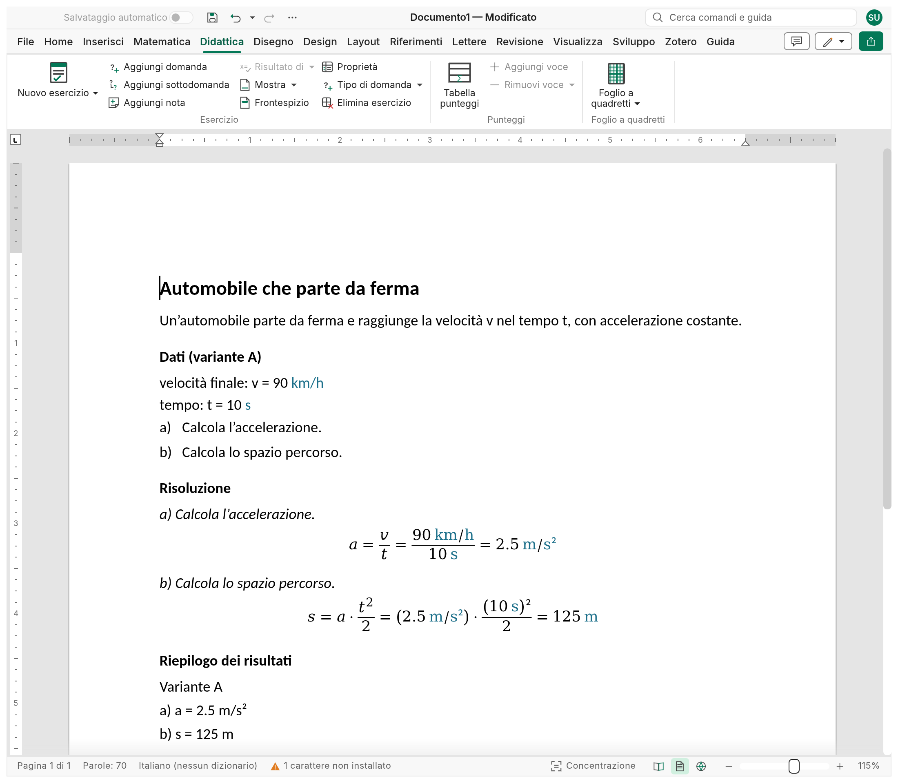
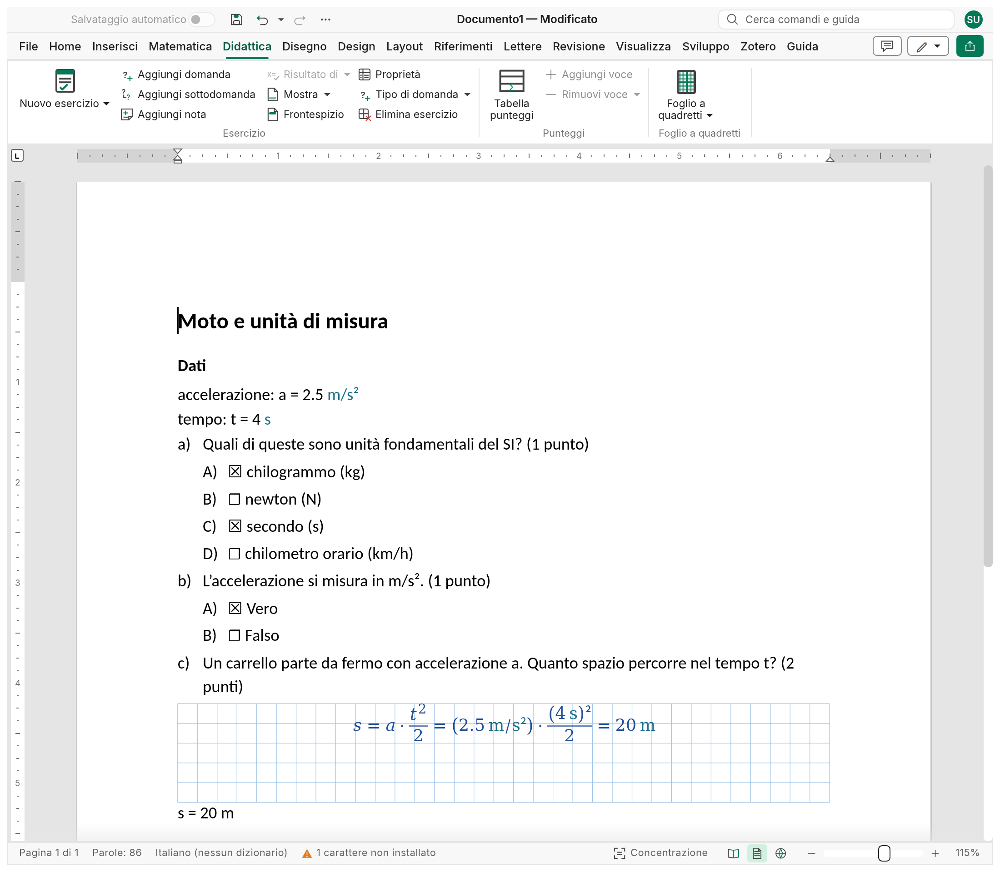
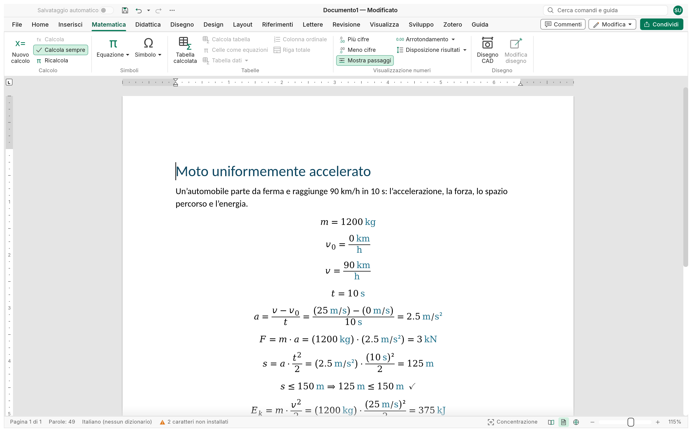

<p align="center">
  
</p>

<h1 align="center">Strix</h1>

<p align="center">
  <b>Momenti di valutazione ed esercizi per il docente: prepara i momenti di valutazione, soluzioni e punteggi li tiene Strix.</b>
</p>

<p align="center">
  Strix è un editor open source, scritto interamente in Rust, per preparare i momenti di valutazione. Gli
  esercizi di calcolo tengono vivi dati, soluzione e risultati, con le varianti A, B, C per ogni
  fila di banchi; le domande a risposta multipla, vero/falso e aperte portano il loro punteggio;
  un file per esercizio fa l'archivio, e da lì si compone il momento di valutazione, con o senza soluzioni. La
  tabella dei punteggi somma da sola i punti per criterio; la griglia che trasforma i punti in
  voti è pianificata. Sotto, le equazioni nella pagina calcolano, con le unità di misura. Gira in
  modo nativo su Windows, macOS, Linux e BSD, e nel browser con WebAssembly.
</p>

<p align="center">
  <a href="https://nabre.github.io/strix/it/"><b>Sito</b></a> ·
  <a href="https://github.com/nabre/strix/releases/latest"><b>Scarica</b></a> ·
  <a href="https://nabre.github.io/strix/app/?sample"><b>Provalo nel browser</b></a> ·
  <a href="https://github.com/nabre/strix/issues"><b>Segnalazioni</b></a>
</p>

<p align="center"><a href="../README.md">English</a> · Italiano · <a href="README.fr.md">Français</a> · <a href="README.de.md">Deutsch</a></p>

> **Stato: alpha.** L'editor di documenti su cui Strix è costruito è maturo; il motore di calcolo,
> gli esercizi e il CAD sono nuovi e cambiano in fretta. Tieni una copia dei documenti importanti e
> [segnalaci cosa non va](https://github.com/nabre/strix/issues). Il README in inglese è il
> riferimento completo.

## Esercizi di calcolo

**Didattica › Esercizio › Nuovo esercizio** inserisce un problema svolto con una struttura che le
modifiche non rompono: titolo, testo, **dati** (simbolo, descrizione, valore, unità), domande con
lettere annidate su tre livelli (a), a.1), a.1.1)); la **soluzione** ripete ogni domanda in sola
lettura con lo spazio per lo svolgimento; un **riepilogo dei risultati** a fine documento
(`a) a = 2.5 m/s²`).

La soluzione è un calcolo vivo (vedi [Matematica WYSIWYG](#matematica-wysiwyg)): i dati possono
avere **varianti** A, B, C… e sceglierne una ricalcola dati, soluzione e riepilogo, così ogni fila
di banchi ha i suoi numeri e nessuna soluzione si rifà a mano. Ogni esercizio è una **sandbox**
(due esercizi possono definire entrambi `t`); dopo le domande può seguire la carta a quadretti, e
un disegno CAD nel testo segue i dati.

<p align="center">
  <picture>
    <source media="(prefers-color-scheme: dark)" srcset="../site/shots/it/shot-exercise-dark.png">
    
  </picture>
</p>

## Risposta multipla e risposta aperta

Un esercizio può essere anche un quiz, e ogni domanda ha la sua modalità, così un quiz le mescola
([question-modes.md](question-modes.md), in inglese):

| Modalità | Copia dello studente | Copia corretta |
|---|---|---|
| **Risposta aperta** | uno spazio di altezza data in cm, a quadretti o bianco | la risposta scritta nello spazio |
| **Risposta multipla** | opzioni A), B), C)… con le caselle vuote | le caselle giuste spuntate (anche più di una) |
| **Vero/falso** | *Vero* e *Falso* con le caselle vuote | quella giusta spuntata |
| **Calcolo** | uno spazio a quadretti per lo svolgimento, poi `s = ______ m` | lo svolgimento con le equazioni vive e `s = 20 m` |
| **Disegno CAD** | uno spazio a quadretti per disegnare | il disegno CAD della soluzione |

Le risposte giuste **si nascondono con la soluzione**: le caselle restano vuote e gli spazi
mantengono l'altezza, così la copia dello studente è impaginata come quella del docente. Ogni
domanda ha i suoi **punti**, mostrati accanto e sommati nella tabella dei punteggi. Il
**problema** (testo, dati, domande, soluzione svolta) resta il tipo per gli esercizi lunghi.

<p align="center">
  <picture>
    <source media="(prefers-color-scheme: dark)" srcset="../site/shots/it/shot-quiz-dark.png">
    
  </picture>
</p>

## Dall'archivio al momento di valutazione

- **Un file per esercizio** fa l'archivio; ogni file porta le sue **proprietà d'archivio**
  (classe, sezione, materia, docente, durata, punteggio), visibili anche in Word
  ([archive.md](archive.md)).
- Un **documento master** compone il momento di valutazione da quei file, con la sua numerazione, il
  frontespizio, i salti di pagina e le parti mostrate (con o senza soluzioni e risultati);
  **i file dell'archivio non cambiano mai** ([master-documents.md](master-documents.md)).
- La **formattazione DSA** (Design › Formattazione documento › DSA) impagina la stessa
  prova per gli studenti con DSA: Lettura, Scrittura, Calcolo e memoria, combinabili, pagina
  sempre bianca ([dsa.md](dsa.md)).
- Esportazione in **PDF** per la stampa.

## Punteggi e voti

La **tabella dei punteggi** (Didattica › Punteggi › Tabella punteggi) ha una riga per esercizio e
due colonne per criterio (IMP, MOD, CAL/RIS…: i punti assegnati sul foglio e quelli che
l'esercizio vale); i **totali** per riga e per colonna seguono mentre scrivi, e il totale
generale è la proprietà **Punteggio** del file.

*Pianificato:* una **griglia per l'assegnazione dei voti** che trasforma i punti in voti (soglie,
scala, arrotondamento). Dettagli (in inglese): [exercise.md](exercise.md).

## Matematica WYSIWYG

Niente foglio separato, niente celle di codice, niente barra della formula. Un'equazione nel
documento *è* il calcolo: scritta sul posto con l'editor di equazioni e mostrata come matematica
impaginata. Strix legge le equazioni calcolate in ordine di lettura e tiene aggiornati i risultati:
dopo ogni modifica (aspettando che il cursore lasci l'equazione), con F9 e all'apertura del file.

```text
m = 1200 kg                        definisce m
v_0 = 0 km/h
v = 90 km/h                        le unità si convertono da sole: km/h, s, m/s
t = 10 s
a = (v − v_0)/t =                  →  a = (v − v₀)/t = 2.5 m/s²
F = m·a =                          →  F = m·a = 3 kN
s = a·t²/2 =                       →  s = a·t²/2 = 125 m
s ≤ 150 m                          →  s ≤ 150 m ⇒ 125 m ≤ 150 m ✓
E_k = m·v²/2 = kJ                  →  E_k = m·v²/2 = 375 kJ        (l'unità scelta dopo =)
v² = 2·a·d                         →  v² = 2·a·d ⇒ d = 125 m         (d è l'unica incognita: ricavata)
```

<p align="center">
  <picture>
    <source media="(prefers-color-scheme: dark)" srcset="../site/shots/it/shot-calc-dark.png">
    
  </picture>
</p>

- **Un solo `=` per tutto**: definizione, risultato da mostrare (anche nell'unità scelta,
  `E_k = kJ`), formula con il suo valore, equazione da **risolvere** per l'unica incognita, o
  **verifica** (`≤ ≥ < > ≠` con ✓/✗).
- **Soluzione**: l'incognita è isolata simbolicamente quando compare una volta, altrimenti
  trovata numericamente.
- **Unità ovunque**: SI con prefissi, unità tecniche (`mm`, `kN`, `MPa`, `bar`, `kWh`…),
  adimensionali conservate (`%`, `‰`, `°`, `rad`). Gli errori dimensionali (`2 m + 3 s`) vengono
  segnalati, mai calcolati in silenzio. L'unità di lavoro segue ciò che scrivi; un'unità con le
  maiuscole sbagliate riceve un suggerimento («forse kN?»).
- **Passaggi della soluzione**, **tabelle calcolate** (colonne con unità e formule, come
  `ρ [g/cm³] = m/V` per le misure di laboratorio, e `Σ =`, `mean =`, `min =`, `max =`), **sommatorie, intervalli e vettori**, **formato numerico**.
- **Gli errori non fermano il foglio**: un'istruzione che non torna mostra `⚠` e il messaggio.

Il calcolo è nella scheda **Matematica**; esercizi, punteggi e carta a quadretti nella scheda **Didattica**. Dettagli (in inglese): [calc.md](calc.md).

## Disegni CAD guidati dai calcoli

**Inserisci › Disegno CAD** mette un disegno tecnico nel testo. Coordinate, raggi e angoli possono
essere **espressioni dei parametri** (`["b", 0]`, `b/2`): cambi `b = 6 cm` e il triangolo si
ridisegna, così ogni variante ha la sua figura; le quote richiamano i parametri (`{{b}}` mostra
`6 cm`). L'editor sul foglio del
disegno ha una riga di comando per le coordinate, **snap esatti** sulle curve vere, grip che
conservano le espressioni, un pannello Proprietà e i layer. Il disegno è salvato in JSON nel file
`.xmath` insieme a un'immagine SVG. Dettagli: [cad.md](cad.md).

## Foglio a quadretti

**Inserisci › Foglio a quadretti** quadretta la pagina o un blocco del testo, come un quaderno, con
una linea più marcata ogni N quadretti, nitida a ogni ingrandimento e in PDF.
Dettagli: [graph-paper.md](graph-paper.md).

## Un editor di documenti completo

Sotto c'è un word processor vero (Strix è un fork di WordCraft): barra multifunzione, stili,
elenchi, tabelle, immagini e forme, intestazioni e piè di pagina, sezioni e colonne, note,
citazioni e sommari, commenti e revisioni, ortografia e sillabazione, stampa unione e stampa.
L'interfaccia segue la lingua del sistema (italiano, inglese, tedesco o francese).

## File

| | Formati |
|---|---|
| **Salva** | `.xmath` (documento) e `.xmathm` (modello): un pacchetto OOXML che mantiene vivi calcoli, esercizi e disegni |
| **Risalva** (documenti senza oggetti Strix) | `.docx`, `.docm`, `.dotx`, `.dotm`, `.odt`, `.rtf`, `.txt`, Word XML |
| **Esporta** (copie statiche) | PDF, PNG, LaTeX, HTML, Markdown |
| **Apre** | `.docx`, `.docm`, `.dotx`, `.dotm`, `.doc`, `.odt`, `.rtf`, `.md`, `.html`, `.tex`, `.txt` |

Strix apre un `.docx` (o `.odt`, `.rtf`…) e lo risalva nello stesso formato, finché il documento
non contiene **oggetti Strix**: calcoli, tabelle calcolate, esercizi, disegni CAD o fogli a
quadretti. Quei formati ne perderebbero gli automatismi di calcolo e il sorgente dei disegni,
quindi un documento che ne contiene si salva solo in `.xmath`: Salva propone un `.xmath` con lo
stesso nome e dice cosa andrebbe perso («3 calcoli, 1 disegno CAD»), Salva con nome esclude i
formati che li perderebbero, e `file.save`, `strix-cli convert` e MCP `save_document` rifiutano con
la stessa spiegazione. Le esportazioni (PDF, PNG, LaTeX, HTML, Markdown) sono copie e funzionano
sempre. Un file `.xmath` resta un pacchetto standard: altri programmi mostrano gli ultimi valori
calcolati.

## Per gli agenti: comandi, CLI, MCP

Tutto ciò che Strix fa è un **comando** in un unico registro. Barra multifunzione, scorciatoie,
ricerca dei comandi, riga di comando, canale di controllo e server MCP eseguono gli stessi comandi,
e le chiamate programmatiche non aprono mai finestre di dialogo.

```sh
claude mcp add strix -- strix-cli mcp                      # documenti senza interfaccia
strix --control 7981 &                                     # oppure guida l'app aperta
claude mcp add strix-app -- strix-cli mcp --connect 127.0.0.1:7981
```

Vedi [mcp.md](mcp.md) e il [protocollo di controllo](control-protocol.md).

## Scarica

Installatori e versioni portabili sono nella [pagina delle release](https://github.com/nabre/strix/releases)
e sul [sito](https://nabre.github.io/strix/it/#download): Windows (MSI, ZIP portabile ed exe portabile, che tiene le impostazioni in una cartella
`StrixData` accanto a sé; x64, x86,
ARM64), macOS (DMG universale), Linux (AppImage, deb, rpm, Flatpak, Arch; x86_64 e aarch64, più
riscv64), FreeBSD e la build web. La firma delle build Windows (SignPath Foundation) è in
attivazione. Privacy: Strix controlla se c'è una nuova versione all'avvio e una volta al giorno
(File › Informazioni), e nient'altro: niente telemetria, niente account; dettagli in
[code-signing.md](code-signing.md) e [updates.md](updates.md).

## Compilare ed eseguire

Serve una toolchain Rust (1.95 o successiva); per la build web anche [Trunk](https://trunkrs.dev/)
e il target `wasm32-unknown-unknown`.

```sh
git clone https://github.com/nabre/strix
cd strix
cargo run --release -p strix -- --sample          # l'app desktop con un documento di esempio
cargo xtask dev                                   # build di debug, ricompilata e riavviata a ogni modifica (watchexec)
                                                  # senza schermo (sandbox, SSH) o con --web: build web su http://127.0.0.1:8771/?sample
cargo run --release -p strix -- problema.xmath    # apre un documento Strix
strix-cli convert problema.xmath problema.pdf     # esportazione statica: pdf, png, tex, html, md
```

Web: `cd apps/strix-web && trunk serve`, poi apri <http://127.0.0.1:8771/?sample>.

## Stato e roadmap

Fatto: calcoli con un solo `=` e unità, tabelle calcolate, esercizi con dati e varianti, quiz
con le cinque modalità di domanda, momenti di valutazione composti dall'archivio con i documenti
master, formattazione DSA, tabella dei punteggi, foglio a quadretti, disegni CAD parametrici.
Le prossime funzionalità sono in via di definizione: [ROADMAP.md](../ROADMAP.md) (con il registro
dei progressi). L'editor di documenti segue la
[roadmap di WordCraft](https://github.com/storytold/wordcraft/blob/main/ROADMAP.md).

## Licenza e crediti

Strix è distribuito con doppia licenza [MIT](../LICENSE-MIT) o [Apache-2.0](../LICENSE-APACHE), a
tua scelta. Copyright (c) 2026 nabre e i contributori di Strix. Strix è un fork di
[WordCraft](https://github.com/storytold/wordcraft) e non è affiliato né approvato dai suoi autori;
le note richieste sono in [NOTICE](../NOTICE). Font, icone, dizionari e traduzioni inclusi
mantengono le loro licenze aperte, elencate in [ATTRIBUTION.md](../ATTRIBUTION.md).
