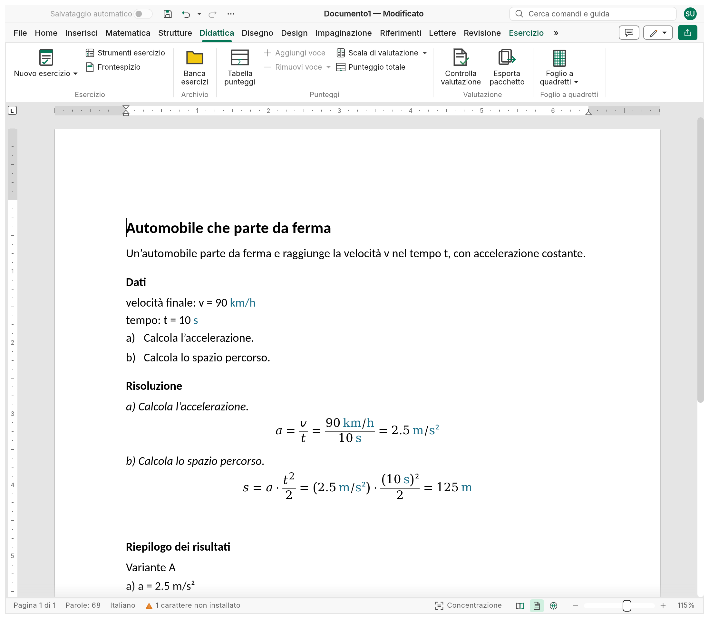
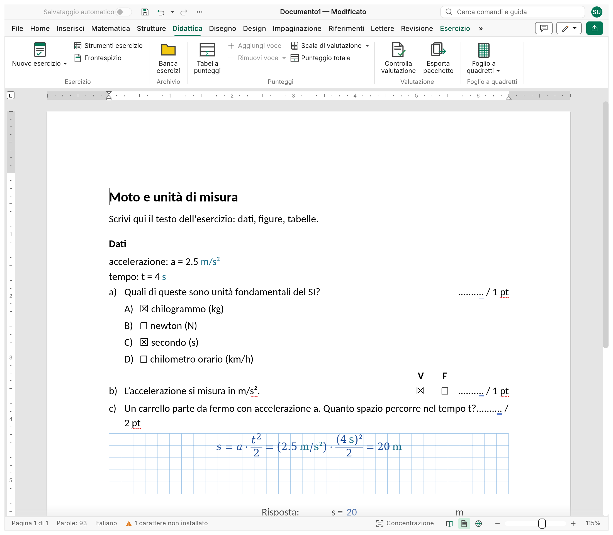
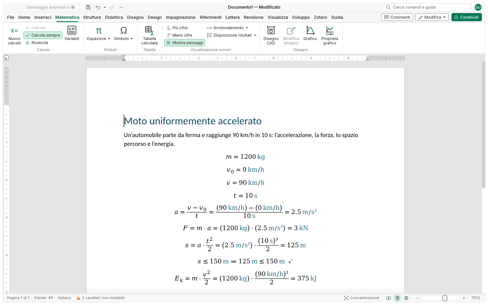
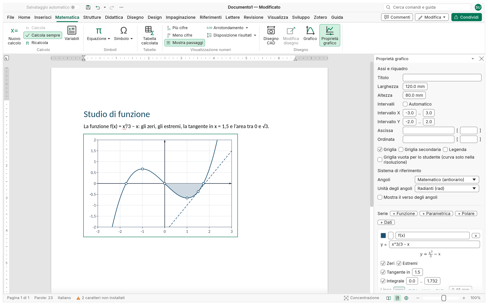
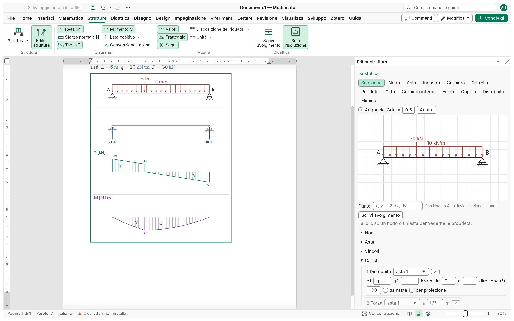

<p align="center">
  
</p>

<h1 align="center">Strix</h1>

<p align="center">
  <b>Momenti di valutazione ed esercizi per il docente: prepara i momenti di valutazione, soluzioni e punteggi li tiene Strix.</b>
</p>

<p align="center">
  Strix è un editor open source, scritto interamente in Rust, per preparare i momenti di valutazione. Gli
  esercizi di calcolo tengono vivi dati, soluzione e risultati, con le varianti A, B, C per ogni
  fila di banchi; le domande a risposta multipla, vero/falso e aperte portano il loro punteggio;
  un file per esercizio fa l'archivio, e da lì si compone il momento di valutazione, con o senza
  soluzioni. La tabella dei punteggi somma da sola i punti per criterio, e la scala di valutazione
  li trasforma in voti. Sotto, le equazioni nella pagina calcolano, con le unità di misura, e
  grafici, disegni CAD e strutture piane le seguono. Gira in modo nativo su Windows, macOS, Linux
  e BSD, e nel browser con WebAssembly.
</p>

<p align="center">
  <a href="https://nabre.github.io/strix/it/"><b>Sito</b></a> ·
  <a href="https://github.com/nabre/strix/releases/latest"><b>Scarica</b></a> ·
  <a href="https://nabre.github.io/strix/app/?sample"><b>Provalo nel browser</b></a> ·
  <a href="https://github.com/nabre/strix/issues"><b>Segnalazioni</b></a>
</p>

<p align="center"><a href="../README.md">English</a> · Italiano · <a href="README.fr.md">Français</a> · <a href="README.de.md">Deutsch</a></p>

> **Stato: alpha.** L'editor di documenti su cui Strix è costruito è maturo; il motore di calcolo,
> gli esercizi, il CAD, i grafici e le strutture sono nuovi e cambiano in fretta. Tieni una copia dei documenti importanti e
> [segnalaci cosa non va](https://github.com/nabre/strix/issues). Il README in inglese è il
> riferimento completo.

## Esercizi di calcolo

**Didattica › Esercizio › Nuovo esercizio** inserisce un problema svolto con una struttura che le
modifiche non rompono: titolo, testo, **dati** (simbolo, descrizione, valore, unità), domande con
lettere annidate su tre livelli (a), a.1), a.1.1)); la **soluzione** ripete ogni domanda in sola
lettura con lo spazio per lo svolgimento; un **riepilogo dei risultati** a fine documento
(`a) a = 2.5 m/s²`).

La soluzione è un calcolo vivo (vedi [Matematica WYSIWYG](#matematica-wysiwyg)): i dati possono
avere **varianti** A, B, C… e sceglierne una ricalcola dati, soluzione e riepilogo, così ogni fila
di banchi ha i suoi numeri e nessuna soluzione si rifà a mano. Ogni esercizio è una **sandbox**
(due esercizi possono definire entrambi `t`); dopo le domande può seguire il foglio a quadretti, e
un disegno CAD, un [grafico](#grafici) o una [struttura](#strutture-piane) nel testo seguono i dati.

Con il cursore in un esercizio compare la scheda **Esercizio**, con domande, varianti e layout;
**Impostazioni della domanda** (tipo e punti di ogni domanda) e **Dati** (un'equazione per dato,
`L = 4.5 m`, con le varianti come pulsanti) si aprono in riquadri accanto al documento. **Genera
varianti** crea nuove varianti da elenchi o intervalli di valori, tenendo solo quelle con
risultati puliti (pochi decimali, positivi, tutti diversi), e ogni variante è controllata mentre
scrivi: una il cui calcolo non torna (unità che non si accordano, la radice di un numero
negativo) viene segnalata subito.

<p align="center">
  <picture>
    <source media="(prefers-color-scheme: dark)" srcset="../site/shots/it/shot-exercise-dark.png">
    
  </picture>
</p>

## Risposta multipla e risposta aperta

Un esercizio può essere anche un quiz, e ogni domanda ha la sua modalità, così un quiz le mescola
([question-modes.md](question-modes.md), in inglese):

| Modalità | Copia dello studente | Copia corretta |
|---|---|---|
| **Risposta aperta** | uno spazio di altezza data in cm, a quadretti o bianco | la risposta scritta nello spazio |
| **Risposta multipla** | opzioni A), B), C)… con le caselle vuote | le caselle giuste spuntate (anche più di una) |
| **Vero/falso** | *Vero* e *Falso* con le caselle vuote | quella giusta spuntata |
| **Calcolo** | uno spazio a quadretti per lo svolgimento, poi `Risposta: s = ______ m` | lo svolgimento con le equazioni vive e `Risposta: s = 20 m` |
| **Disegno CAD** | uno spazio a quadretti per disegnare, o una figura da completare | il disegno CAD della soluzione, o la figura completata |
| **Completamento in linea** | un testo con una riga su cui scrivere per ogni parola nascosta (o valore calcolato) | le parole nascoste, nello stile *Parola nascosta* |
| **Abbinamento** | due colonne, quella di destra mescolata, con le caselle per le lettere | le lettere delle coppie giuste |
| **Esempio svolto** | l'esempio con la sua soluzione, sempre visibile, senza punti | lo stesso |

Le risposte giuste **si nascondono con la soluzione**: le caselle restano vuote e gli spazi
mantengono l'altezza, così la copia dello studente è impaginata come quella del docente. Ogni
domanda ha i suoi **punti**, mostrati accanto e sommati nella tabella dei punteggi. Il
**problema** (testo, dati, domande, soluzione svolta) resta il tipo per gli esercizi lunghi.

<p align="center">
  <picture>
    <source media="(prefers-color-scheme: dark)" srcset="../site/shots/it/shot-quiz-dark.png">
    
  </picture>
</p>

## Dall'archivio al momento di valutazione

- **Un file per esercizio** fa l'archivio; ogni file porta le sue **proprietà d'archivio**
  (classe, sezione, materia, docente, durata, argomenti, punteggio), visibili anche in Word. Il
  riquadro **Banca esercizi** (Didattica › Archivio) cerca in una cartella di esercizi per
  proprietà e testo e ne inserisce uno come copia o come sottodocumento collegato
  ([archive.md](archive.md)).
- Un **documento master** compone il momento di valutazione da quei file, con la sua numerazione, il
  frontespizio, i salti di pagina e le parti mostrate (con o senza soluzioni e risultati);
  **i file dell'archivio non cambiano mai** ([master-documents.md](master-documents.md)).
- La **formattazione DSA** (il gruppo **DSA** della scheda Design) impagina la stessa prova per
  gli studenti con DSA: Lettura, Scrittura, Calcolo e memoria, combinabili, pagina sempre bianca
  ([dsa.md](dsa.md)).
- **Controlla valutazione** (Didattica › Valutazione) rivede il momento di valutazione prima della
  stampa: tutte le varianti, le risposte giuste, le soluzioni mancanti, i punti e i loro totali,
  gli spazi di risposta, la durata e le pagine di ogni variante, ogni problema a un clic.
- **Esporta pacchetto** (Didattica › Valutazione) scrive in un passo il PDF degli studenti per ogni
  variante, la loro versione DSA e la copia del docente con le soluzioni svolte, la scala di
  valutazione e una tabella con i risultati di tutte le varianti.
- Esportazione in **PDF** per la stampa.

## Punteggi e voti

La **tabella dei punteggi** (Didattica › Punteggi › Tabella punteggi) ha una riga per esercizio e
due colonne per criterio (IMP, MOD, CAL/RIS…: i punti assegnati sul foglio e quelli che
l'esercizio vale); i **totali** per riga e per colonna seguono mentre scrivi, e il totale
generale è la proprietà **Punteggio** del file.

La **scala di valutazione** (Didattica › Punteggi › Scala di valutazione) trasforma i punti in
voti: una tabella con una riga per voto, dal più basso al più alto con il passo che scegli (da 1 a
10 di mezzo in mezzo, per esempio), e i punti che lo danno come intervallo `[12; 14[`. Parte da
una preimpostazione scolastica (Italia 1–10, Svizzera 1–6, Germania 6–1, Francia 0–20,
percentuale) o dalla tua: la soglia di sufficienza e il suo voto, una retta o due, i punti
arrotondati a un multiplo (0,25, 0,5), il massimo preso dalla tabella dei punteggi o fisso, e se
gli studenti la vedono. **Proprietà scala di valutazione** si apre accanto al documento con
un'anteprima, i voti sufficienti in verde. Dettagli (in inglese): [exercise.md](exercise.md).

## Matematica WYSIWYG

Niente foglio separato, niente celle di codice, niente barra della formula. Un'equazione nel
documento *è* il calcolo: scritta sul posto con l'editor di equazioni e mostrata come matematica
impaginata. Strix legge le equazioni calcolate in ordine di lettura e tiene aggiornati i risultati:
dopo ogni modifica (aspettando che il cursore lasci l'equazione), con F9 e all'apertura del file.

```text
m = 1200 kg                        definisce m
v_0 = 0 km/h
v = 90 km/h                        le unità si convertono da sole: km/h, s, m/s
t = 10 s
a = (v − v_0)/t =                  →  a = (v − v₀)/t = 2.5 m/s²
F = m·a =                          →  F = m·a = 3 kN
s = a·t²/2 =                       →  s = a·t²/2 = 125 m
s ≤ 150 m                          →  s ≤ 150 m ⇒ 125 m ≤ 150 m ✓
E_k = m·v²/2 = kJ                  →  E_k = m·v²/2 = 375 kJ        (l'unità scelta dopo =)
v² = 2·a·d                         →  v² = 2·a·d ⇒ d = 125 m         (d è l'unica incognita: ricavata)
```

<p align="center">
  <picture>
    <source media="(prefers-color-scheme: dark)" srcset="../site/shots/it/shot-calc-dark.png">
    
  </picture>
</p>

- **Un solo `=` per tutto**: definizione, risultato da mostrare (anche nell'unità scelta,
  `E_k = kJ`), formula con il suo valore, equazione da **risolvere** per l'unica incognita, o
  **verifica** (`≤ ≥ < > ≠` con ✓/✗).
- **Soluzione**: l'incognita è isolata simbolicamente quando compare una volta, altrimenti
  trovata numericamente.
- **Unità ovunque**: SI con prefissi, unità tecniche (`mm`, `kN`, `MPa`, `bar`, `kWh`…),
  adimensionali conservate (`%`, `‰`, `°`, `rad`). Gli errori dimensionali (`2 m + 3 s`) vengono
  segnalati, mai calcolati in silenzio. L'unità di lavoro segue ciò che scrivi; un'unità con le
  maiuscole sbagliate riceve un suggerimento («forse kN?»).
- **Passaggi della soluzione**, **tabelle calcolate** (colonne con unità e formule, come
  `ρ [g/cm³] = m/V` per le misure di laboratorio, e `Σ =`, `mean =`, `min =`, `max =`), **sommatorie, intervalli e vettori**, **formato numerico**.
- **Derivate, integrali e limiti**: `f′(a)` e `f″(a)` di una funzione definita da te
  (`f(x) = …`), integrali definiti `∫_a^b f(x) dx` con le unità, limiti da destra e da sinistra,
  somme binomiali; le strutture dell'editor di equazioni (valore assoluto, radici con indice,
  logaritmi in base, sistemi di casi, determinanti) si leggono come calcoli. `°C` e `°F` si
  convertono come temperature e come differenze.
- **Il riquadro Variabili** (Matematica › Calcolo › Variabili) elenca ogni nome definito fin lì
  con il suo valore, e converte le unità.
- **Gli errori non fermano il foglio**: un'istruzione che non torna mostra `⚠` e il messaggio.

Il calcolo è nella scheda **Matematica** (con Tabella calcolata, che ha una scheda sua mentre il
cursore è in una tabella, il formato numerico, Disegno CAD e Grafico); le strutture hanno la
scheda **Strutture**; esercizi, punteggi, scala di valutazione e foglio a quadretti sono nella
scheda **Didattica**. Dettagli (in inglese): [calc.md](calc.md).

## Disegni CAD guidati dai calcoli

**Inserisci › Disegno CAD** mette un disegno tecnico nel testo. Coordinate, raggi e angoli possono
essere **espressioni dei parametri** (`["b", 0]`, `b/2`): cambi `b = 6 cm` e il triangolo si
ridisegna, così ogni variante ha la sua figura; le quote richiamano i parametri (`{{b}}` mostra
`6 cm`). L'editor sul foglio del
disegno, con le sue schede (**Disegno CAD**, **Annotazioni CAD**, **Output CAD**), ha una riga di
comando per le coordinate, **snap esatti** sulle curve vere, grip che conservano le espressioni,
quote allineate, orizzontali, verticali e angolari, tratteggi, e gli strumenti di modifica
(sposta, copia, ruota, scala, specchia, offset, taglia, estendi, raccorda, cima, serie), ciascuno
con l'anteprima prima del clic; un pannello Proprietà e i layer. Il disegno è salvato in JSON nel
file insieme a un'immagine SVG. *Pianificato:* quote che comandano il disegno, con vincoli
geometrici. Dettagli: [cad.md](cad.md).

## Grafici

**Matematica › Disegno › Grafico** disegna nel testo un grafico cartesiano vivo, dai calcoli che
lo precedono ([plot.md](plot.md)): funzioni `y = f(x)` (poli e asintoti mai uniti),
curve parametriche e polari, dati sperimentali da una tabella calcolata con le barre d'errore e
una regressione lineare o quadratica con R². Una funzione può mostrare **zeri**, **estremi**, una
**tangente** e un **integrale** con l'area tratteggiata; **Inserisci analisi nel documento** li
scrive dopo il grafico come calcoli vivi. Gli assi hanno il nome sulle frecce, e quei nomi sono le
variabili delle formule; gli intervalli si adattano a ciò che c'è da mostrare; gli angoli vanno nel
verso matematico o topografico, in rad, ° o gon. Cambi un parametro e il grafico si ridisegna;
nella copia dello studente un grafico (o una sola curva) segnato come soluzione lascia una griglia
vuota e graduata della stessa misura. Il riquadro **Proprietà grafico** modifica ogni serie.

<p align="center">
  <picture>
    <source media="(prefers-color-scheme: dark)" srcset="../site/shots/it/shot-plot-dark.png">
    
  </picture>
</p>

## Strutture piane

La scheda **Strutture** (tra Matematica e Didattica) inserisce una **trave, un telaio o una
travatura reticolare** che viene risolta dove si trova e disegnata come sul libro di testo
([structures.md](structures.md)): la struttura con vincoli e carichi, le **reazioni vincolari** e
i **diagrammi di N, T e M** uno sotto l'altro alla stessa scala, tratteggiati, con ⊕/⊖ e i valori
notevoli; una reticolare mostra lo sforzo normale di ogni asta, trazione e compressione in due
colori. Ogni carico ha il suo nome (`F_1`, `q_2`, `C_3`), il disegno porta le **quote** della
struttura, le inclinazioni e gli angoli delle forze, e i diagrammi segnano le **progressive** (dove
cade un valore notevole, misurato dall'inizio dell'asta).

- **Qualsiasi struttura piana**: incastri, cerniere, carrelli, pendoli e doppi pendoli con
  qualsiasi inclinazione, cerniere interne; forze, coppie e carichi distribuiti uniformi,
  triangolari o trapezi, in assi globali o locali, per unità di lunghezza o di proiezione. Viene
  classificata isostatica, iperstatica di grado *h* o labile, e risolta con il metodo degli
  spostamenti.
- **Guidata dai calcoli**: ogni lunghezza e carico può essere un parametro (`L`, `q`), così ogni
  variante di un esercizio ha la sua struttura e i suoi diagrammi; la convenzione italiana
  (momento dalla parte delle fibre tese) è quella predefinita, e il lato positivo di ogni
  diagramma si può scegliere.
- **L'editor della struttura**: un doppio clic su una struttura la apre al posto della pagina,
  con la sua scheda della barra multifunzione: un foglio con griglia e snap, strumenti per nodi,
  aste, vincoli, cerniere e carichi, selezione con clic e finestra, maniglie per spostare i nodi,
  portare e ruotare i carichi e allungare i distribuiti, un menu del tasto destro (dividere o
  unire aste, vincoli, cerniere, carichi), coordinate digitate, le proprietà della selezione e le
  tabelle di nodi, aste, vincoli e carichi.
- **Lo svolgimento scritto**: **Scrivi svolgimento** mette la soluzione dopo la struttura come
  calcoli vivi: prima i carichi, le loro risultanti e componenti e il braccio di ogni forza, poi
  le equazioni di equilibrio scritte in forma letterale (`0 kN·m = V_B·6 m − F_1·d_(1,A)`), ognuna
  risolta per la sua reazione con i passaggi, poi le leggi di ogni asta (`T_1(x) = V_A − q_1·x`)
  tratto per tratto, con i valori agli estremi e i massimi del momento. Lo svolgimento segue la
  struttura: ogni modifica, o a un parametro che legge, lo riscrive.
- **Un esercizio sulla struttura**: **Esercizio su struttura** scrive un problema intero (la
  struttura nel testo; reazioni, N, T, dove T si annulla, il momento massimo lì, M), ogni
  risposta con il suo svolgimento e il suo disegno; **Passa a esercizio** e **Passa a struttura**
  trasformano una struttura da relazione tecnica a esercizio e viceversa, dove si trova.
- Nella copia dello studente le reazioni e i diagrammi restano fuori e i riquadri vuoti
  rimangono, così le due copie hanno la stessa impaginazione.

<p align="center">
  <picture>
    <source media="(prefers-color-scheme: dark)" srcset="../site/shots/it/shot-structure-dark.png">
    
  </picture>
</p>

## Foglio a quadretti

**Inserisci › Foglio a quadretti** quadretta la pagina o un blocco del testo, come un quaderno, con
una linea più marcata ogni N quadretti, nitida a ogni ingrandimento e in PDF.
Dettagli: [graph-paper.md](graph-paper.md).

## Un editor di documenti completo

Sotto c'è un word processor vero (Strix è un fork di WordCraft): barra multifunzione, stili,
elenchi, tabelle, immagini e forme, intestazioni e piè di pagina, sezioni e colonne, note,
citazioni e sommari, commenti e revisioni, ortografia e sillabazione, stampa unione e stampa.
L'interfaccia segue la lingua del sistema (italiano, inglese, tedesco o francese; File › Opzioni
› Lingua dell'interfaccia ne sceglie una a mano).

## File

| | Formati |
|---|---|
| **Salva** | `.xmath` (documento) e `.xmathm` (modello), e i file di Word `.docx`, `.docm`, `.dotx`, `.dotm`: tutti mantengono vivi calcoli, esercizi, disegni, grafici e strutture |
| **Risalva** (documenti senza oggetti Strix) | `.odt`, `.rtf`, `.txt`, Word XML |
| **Esporta** (copie statiche) | PDF, PNG, LaTeX, HTML, Markdown |
| **Apre** | `.xmath`, `.xmathm`, `.docx`, `.docm`, `.dotx`, `.dotm`, `.doc`, `.odt`, `.rtf`, `.md`, `.html`, `.tex`, `.txt`, Word XML |

Un documento nuovo è un `.xmath`, e come Word, Strix risalva un file nel formato da cui viene.
**I file di Word conservano gli oggetti Strix anche passando da Word**: un `.docx` scritto da Strix
porta ogni calcolo, tabella calcolata, esercizio, disegno CAD, grafico, struttura e foglio a
quadretti una seconda volta, in controlli contenuto e in una parte XML personalizzata che Word
conserva quando salva. Apri il file in Word, modifica il testo intorno, salva, e in Strix gli
oggetti tornano vivi; uno modificato in Word resta come Word l'ha lasciato e aspetta che tu decida
([word-round-trip.md](word-round-trip.md), in inglese). Gli altri formati modificabili (ODT, RTF,
testo semplice, Word XML) ne terrebbero solo l'ultimo aspetto, quindi un documento che ne contiene
non si salva in quei formati: Salva propone un `.xmath` e dice cosa andrebbe perso («3 calcoli, 1
disegno CAD»), Salva con nome li esclude, e `file.save`, `strix-cli convert` e MCP `save_document`
rifiutano con la stessa spiegazione. Le esportazioni (PDF, PNG, LaTeX, HTML, Markdown) sono copie e
funzionano sempre. Un file `.xmath` resta un pacchetto standard: altri programmi mostrano gli
ultimi valori calcolati.

## Per gli agenti: comandi, CLI, MCP

Tutto ciò che Strix fa è un **comando** in un unico registro. Barra multifunzione, scorciatoie,
ricerca dei comandi, riga di comando, canale di controllo e server MCP eseguono gli stessi comandi,
e le chiamate programmatiche non aprono mai finestre di dialogo. Fra i comandi della didattica,
del calcolo e del disegno ci sono `exercise.insert`, `exercise.setData`, `exercise.variant`,
`exercise.generateVariants`, `exercise.scores`, `exercise.grading`, `exercise.check`,
`file.exportPack`, `design.dsa`, `calc.insert`, `table.calc`, `insert.cad`, `plot.insert`,
`plot.analysis`, `structure.insert`, `structure.working`, `structure.exercise` e
`structure.mode`: un agente può preparare un intero
momento di valutazione, con le varianti, la scala di valutazione e le copie da stampare.

```sh
claude mcp add strix -- strix-cli mcp                      # documenti senza interfaccia
strix --control 7981 &                                     # oppure guida l'app aperta
claude mcp add strix-app -- strix-cli mcp --connect 127.0.0.1:7981
```

Vedi [mcp.md](mcp.md) e il [protocollo di controllo](control-protocol.md).

## Scarica

Installatori e versioni portabili sono nella [pagina delle release](https://github.com/nabre/strix/releases)
e sul [sito](https://nabre.github.io/strix/it/#download): Windows (MSI, ZIP portabile ed exe portabile, che tiene le impostazioni in una cartella
`StrixData` accanto a sé; x64, x86,
ARM64), macOS (DMG universale), Linux (AppImage, deb, rpm, Flatpak, Arch; x86_64 e aarch64, più
riscv64), FreeBSD e la build web. La firma delle build Windows (SignPath Foundation) è in
attivazione. Privacy: Strix controlla se c'è una nuova versione all'avvio e una volta al giorno
(File › Informazioni), e nient'altro: niente telemetria, niente account; dettagli in
[code-signing.md](code-signing.md) e [updates.md](updates.md).

## Compilare ed eseguire

Serve una toolchain Rust (1.95 o successiva); per la build web anche [Trunk](https://trunkrs.dev/)
e il target `wasm32-unknown-unknown`.

```sh
git clone https://github.com/nabre/strix
cd strix
cargo run --release -p strix -- --sample          # l'app desktop con il momento di valutazione di esempio
cargo xtask dev                                   # build di debug, ricompilata e riavviata a ogni modifica (watchexec)
                                                  # senza schermo (sandbox, SSH) o con --web: build web su http://127.0.0.1:8771/?sample
cargo run --release -p strix -- problema.xmath    # apre un documento Strix
strix-cli convert problema.xmath problema.pdf     # esportazione statica: pdf, png, tex, html, md
```

Web: `cd apps/strix-web && trunk serve`, poi apri <http://127.0.0.1:8771/?sample>.

## Stato e roadmap

Fatto: calcoli con un solo `=` e unità, derivate, integrali e limiti, tabelle calcolate, esercizi
con dati e varianti (generate e controllate), quiz con tutte le modalità di domanda, momenti di
valutazione composti dall'archivio con i documenti master, formattazione DSA, controllo prima
della stampa ed esportazione del pacchetto, tabella dei punteggi e scala di valutazione, foglio a
quadretti, disegni CAD parametrici con gli strumenti di modifica, grafici con la loro analisi,
strutture piane con lo svolgimento e i loro esercizi, file Word che conservano gli oggetti Strix. Prossimi passi
annotati: sistemi di equazioni e matrici, una tabella dei risultati per esercizio e un riepilogo
per variante, domande di ordinamento, quote CAD che comandano il disegno.
I dettagli sono in [ROADMAP.md](../ROADMAP.md) (con il registro
dei progressi). L'editor di documenti segue la
[roadmap di WordCraft](https://github.com/storytold/wordcraft/blob/main/ROADMAP.md).

## Licenza e crediti

Strix è distribuito con doppia licenza [MIT](../LICENSE-MIT) o [Apache-2.0](../LICENSE-APACHE), a
tua scelta. Copyright (c) 2026 nabre e i contributori di Strix. Strix è un fork di
[WordCraft](https://github.com/storytold/wordcraft) e non è affiliato né approvato dai suoi autori;
le note richieste sono in [NOTICE](../NOTICE). Font, icone, dizionari e traduzioni inclusi
mantengono le loro licenze aperte, elencate in [ATTRIBUTION.md](../ATTRIBUTION.md). Microsoft e
Word sono marchi di Microsoft Corporation; Strix è un progetto indipendente, non affiliato,
approvato o sponsorizzato da Microsoft, e legge e scrive i file di Word a partire dalle specifiche
pubblicate (ECMA-376, ISO/IEC 29500).
