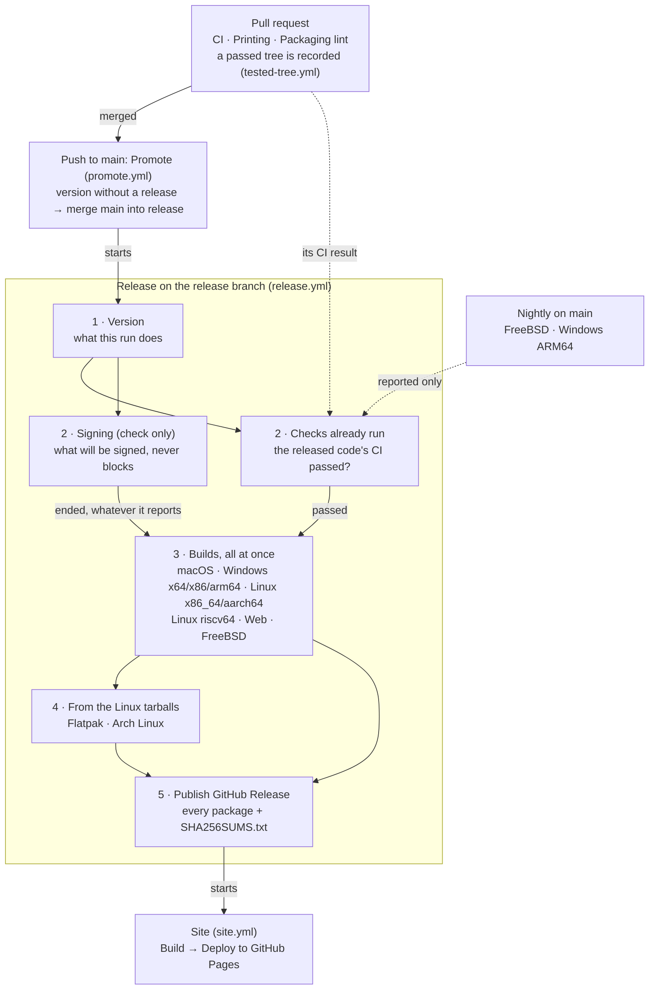

<!-- Modified by the Strix contributors (fork of WordCraft); see NOTICE. -->
# Releasing Strix

The canonical recipe is [craftrules `release/playbook.md`](https://github.com/storytold/craftrules/blob/main/release/playbook.md);
this file has the Strix specifics.

## The release flow

Four workflows follow each other; GitHub draws only the jobs of one run, so this diagram is printed
in the summary of every Promote and Release run too, with what that run does marked
(`.github/release-flow.sh` reads it from here: keep the node ids). Solid arrows: what waits for
what. Dotted: results read or reported, which never start anything.

The numbers are in the job names, so GitHub's graph and job list read in the same order. Phase 2
(preflight) decides for every platform: no build starts before the released code's CI is known to
have passed, so a failed CI costs no build minutes.

## Steps

1. Bump the version on `main`: `cargo xtask version set 0.2.0` (the one source of truth is
   `[workspace.package] version`; the app shows it in `--version` and About, with the commit from
   `WORDCRAFT_BUILD_SHA`).
2. Merge it into `main`. `.github/workflows/promote.yml` runs on every push to `main`; its one
   job, **Promote main to release**, checks whether `v<version>` is already a published GitHub
   Release. If it is, it stops there. If it isn't, it merges that commit into the `release`
   branch and starts the Release workflow (`.github/workflows/release.yml`) there (signed builds
   run only on `release`: the `release` environment gives its signing secrets to that branch
   alone, and SignPath signs only requests from it). Merging `main` into `release` by hand and
   pushing does the same. Release doesn't run on `main` (run by hand there, it does nothing). On
   `release`, after the preflight (**Checks already run** and **Signing**), it builds every
   package:

| Platform | Artifacts | Signing |
|---|---|---|
| macOS | universal `Strix.app` in a `.dmg`, universal CLI zip | Developer ID + notarization (`APPLE_*` secrets) |
| Windows | x64, x86 and arm64 `.msi` (one dual-scope package: per-user by default, needs no admin rights; "Everyone on this computer" installs per machine) + portable `.zip` + single-file portable `.exe` (see below) | Azure Trusted Signing (`AZURE_*` secrets) |
| Linux | x86_64 and aarch64 `.AppImage` (+ `.zsync` for AppImageUpdate), `.flatpak` bundle, `.deb`, `.rpm`, `.tar.gz`; Flathub manifest | checksums |
| Linux riscv64 | `.tar.gz` (cross-compiled on `ubuntu-24.04`, glibc >= 2.39; CLI smoke-tested under QEMU) | checksums |
| FreeBSD | x86_64 `.tar.gz` | checksums |
| Web | `strix-web-<version>.zip` (static site: `index.html`, wasm, glue) | none |

**Windows portable builds.** `strix-<version>-windows-<arch>-portable.zip` holds `strix.exe`,
`strix-cli.exe`, the notices and a `StrixData` folder (with a README); `strix-<version>-windows-<arch>-portable.exe`
is the signed `strix.exe` alone, renamed. Both run in **portable mode**
(`crates/control-key/src/portable.rs`, through `wordcraft_control_key::settings_dir`): when a
`StrixData` folder sits beside the running program, or the program's file name contains
`portable` (then `StrixData` is made on the first run, so a later rename keeps it), every
per-user file lives in `StrixData` instead of `%APPDATA%\Strix`: preferences (`ui.json`), logs,
recovery copies, the custom dictionary, personal templates, added fonts, control-key files, and
extra Hunspell dictionaries (`StrixData\dictionaries`). A portable run writes nothing to the
registry and hides File › Options › Make Strix the default. When `StrixData` can't be made or
written (a read-only drive, Program Files), Strix uses `%APPDATA%\Strix` and logs why.
`WORDCRAFT_PROFILE_DIR` still overrides both. The rule is the same on every platform, but only the
Windows builds ship portable.

3. Once every build has passed and the commit's CI too, the run publishes the release
   `Strix v<version>` (tag `v<version>` on the built commit, notes generated by GitHub, marked
   latest; a version with a hyphen, `0.22.0-rc.1`, is a pre-release) with every package and
   `SHA256SUMS.txt`. Complete its title afterwards as `Strix v<version> — <highlights>` (every
   release is titled this way). A tag made without a release (by hand) is built from the tag's
   commit, if its Cargo.toml carries the same version; a draft left by the old flow is replaced.
   There is one release workflow and no draft to publish by hand.

   **Promote main to release** uses `GITHUB_TOKEN`, which can't push a merge that changes
   `.github/workflows/`: then it fails with that reason, and `main` is merged into `release` by
   hand, unless the repository secret `RELEASE_PUSH_TOKEN` (a fine-grained token with Contents
   and Workflows write on this repository) is set, which the job uses instead. A conflict on
   `release` fails the same way. A merge pushed with `GITHUB_TOKEN` starts no workflow, so the job
   starts Release on `release` itself; one pushed with `RELEASE_PUSH_TOKEN` starts it through the
   push, and the job then doesn't start it again (one run per release, never two).

   Publishing redeploys the site (`site.yml`, started by the release run: a release published
   with `GITHUB_TOKEN` starts no other workflow), so the download links and the browser version
   at <https://nabre.github.io/strix/app/> move to the new release. A release published by hand
   on GitHub starts it too. To redeploy by hand: `gh workflow run site.yml --ref main`.

   The site always deploys from `main`: the `github-pages` environment refuses tags, so the run
   a release published on GitHub starts (on its tag) only starts `site.yml` again on `main`.
   The download links take the version of the latest *published* release
   (`cargo xtask site --version`), never Cargo.toml's.

   A push to `main` made while a release is building is promoted too (the version has no
   release yet): the Release run it starts on `release` waits for the one building (one run at
   a time per branch, never cancelled), then finds the release published and stops at
   **Version**.

## How the pipeline is built

`.github/workflows/release.yml` is Strix's own pipeline: it reuses the suite's composite actions
(`storytold/craft-common-actions/actions/*`) but not its reusable release workflow, which requires
signing on the `release` branch (as here) and runs macOS on the paid `macos-15-xlarge` runner. Here:

- **Every platform builds whether or not it can be signed.** The **Signing (check only)** job
  reads the secrets and reports, as warnings and in the run's summary, what will be signed: it
  never fails the run. Without `APPLE_CERTIFICATE` macOS is ad-hoc signed and not notarized
  (Gatekeeper asks users to allow the app); without a `WINDOWS_CERTIFICATE` pair or the six
  `AZURE_*` secrets Windows is unsigned (SmartScreen warns).
- macOS builds on the standard `macos-latest` runner (Apple silicon, the x86_64 half too).
- FreeBSD x86_64 builds in a VM (`vmactions/freebsd-vm`): the app and the CLI in a tar.gz.
- Every build waits for the preflight: **Checks already run** must pass, **Signing** must only
  have ended (in a dry run the `release` environment refuses it, and the builds go on). The
  release waits for every build.
- **Each check runs once.** The release doesn't run again what other workflows already checked;
  **Checks already run** reads their results before the builds start:
  - CI (`ci.yml`, `cargo xtask ci`) of the released code: the built commit's run or, when
    `release` got `main` through a merge commit, the run of the `main` commit merged in. Still
    running: waited for. **Failed: nothing is built or published** (fix it on `main`: the next
    push brings the fix into `release`). No run found: a warning. In a dry run it only reports
    (a failed or unfinished CI is a warning, not waited for) and the packages are still built.
  - The last completed nightly **FreeBSD** (`freebsd.yml`: build and tests in a VM) and **Windows
    ARM64** (`windows-arm64.yml`: the ARM64 MSI installed and run on an ARM64 runner) runs on
    `main`, reported in the summary, a warning when one failed. Start one by hand
    (`gh workflow run freebsd.yml --ref main`) to check the latest `main` before bumping.
  - Packaging lint runs on `main` and on PRs that change packaging, not again in the release.
  - CI, Printing and Packaging lint don't run again on a push to `main` whose code a PR already
    passed (`tested-tree.yml`): a PR run whose checks pass records its tree (the merge of the PR
    into `main`) as a small artifact, and the push that merges it, with the same tree when `main`
    didn't move meanwhile, skips its jobs and still ends "success", so **Checks already run**
    finds the CI passed. A fork's PR doesn't count; any doubt runs the checks. Because only runs
    on `main` save the dependency caches, CI and Printing also run nightly on `main`, skipped when
    `main` has no new code since its last full run.
  - A draft PR, or one that changes only documentation (Markdown files other than
    `ATTRIBUTION.md`), doesn't run CI, Printing, Packaging lint, FreeBSD or Windows ARM64
    (`pr-scope.yml`): their jobs are skipped, the run still ends "success" and no tree is recorded,
    so the push that merges it runs them. A draft's checks run when it is marked Ready for review.
  - SonarCloud runs only on pushes to `main` (and by hand), not on pull requests: its analysis
    builds the code again and took a runner beside CI on every PR push.
- `cargo xtask workflows` (in `cargo xtask ci`) keeps the workflows in step: every action from
  outside the suite pinned to a full commit SHA, one commit per action, one craft-fonts commit
  in every workflow. The suite's own `storytold/…` actions follow `@main` on purpose.

Signing secrets live in the repository's `release` environment, synced from the release manager's
machine (`craftrules/release/signing-setup.md`); set them and the next run signs.

The packaging scripts must keep their executable bit in git (`git update-index --chmod=+x`):
a checkout made on Windows drops it, and the jobs then fail with "Permission denied" (first
release, 0.12.0).

Local packaging: `packaging/macos/package.sh --arch universal`, `packaging/windows/package.ps1`
(or double-click `packaging\windows\package.bat`: x64 by default, `-Arch x86|arm64` and `-SkipBuild`
passed through; the packages land in `dist\release`, or `%DIST%`, and the folder opens),
`packaging/linux/package.sh` (then `packaging/linux/flatpak-bundle.sh` for the Flatpak), `packaging/web/package.sh`.

Dry run: `gh workflow run release.yml --ref <branch>` on any branch but `main` and `release`
builds the unsigned jobs (version, Linux, Linux riscv64, Flatpak, Arch, FreeBSD, web) and
publishes nothing; the signing jobs (Signing, macOS, Windows) are refused there by the `release`
environment's branch rule, and the run ends "failure" for them alone.
